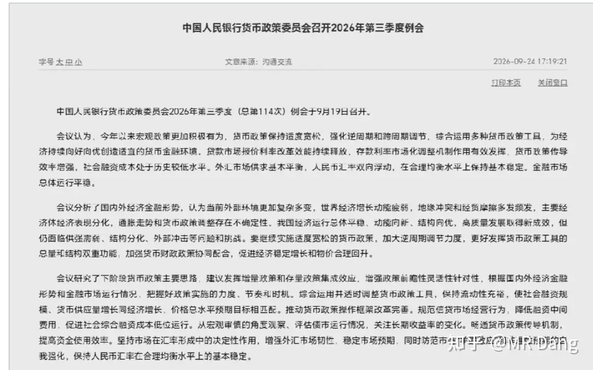
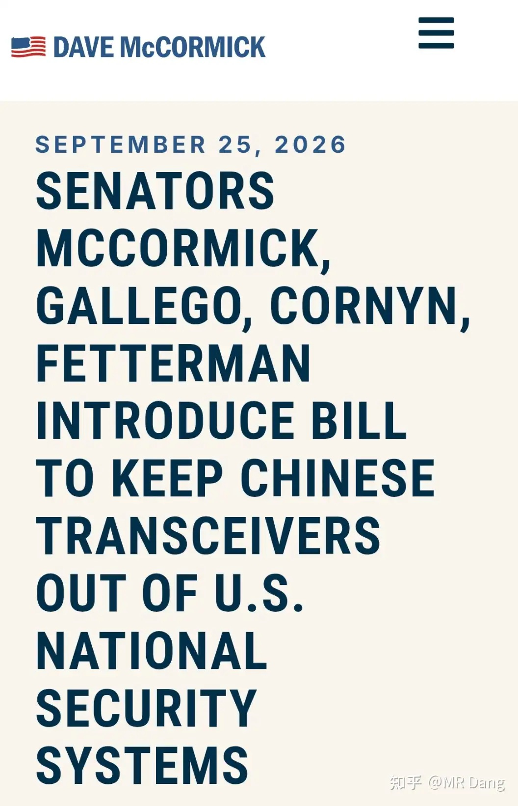
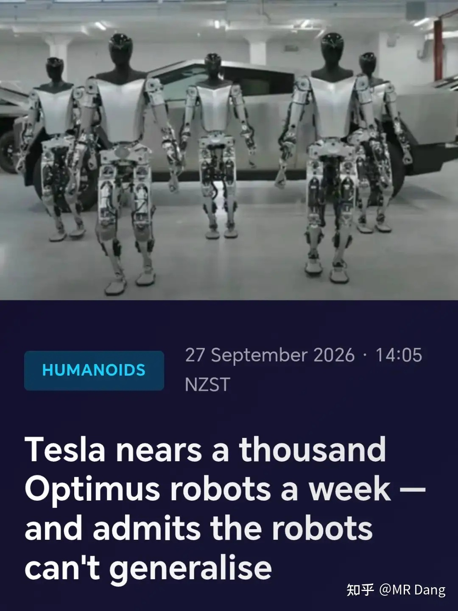
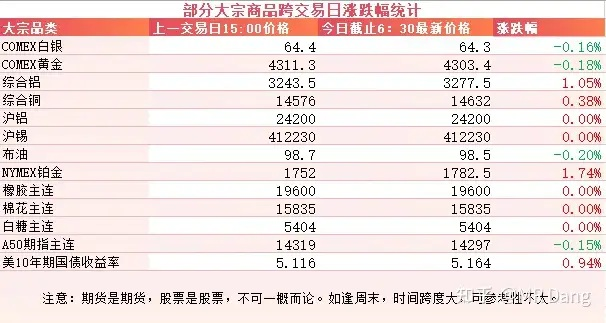
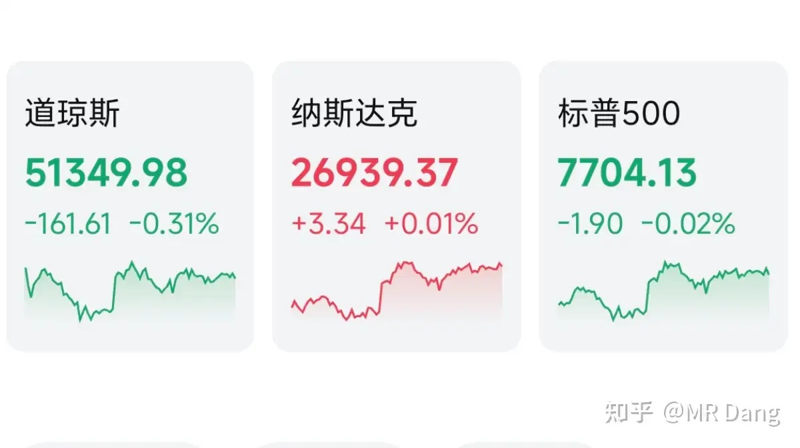
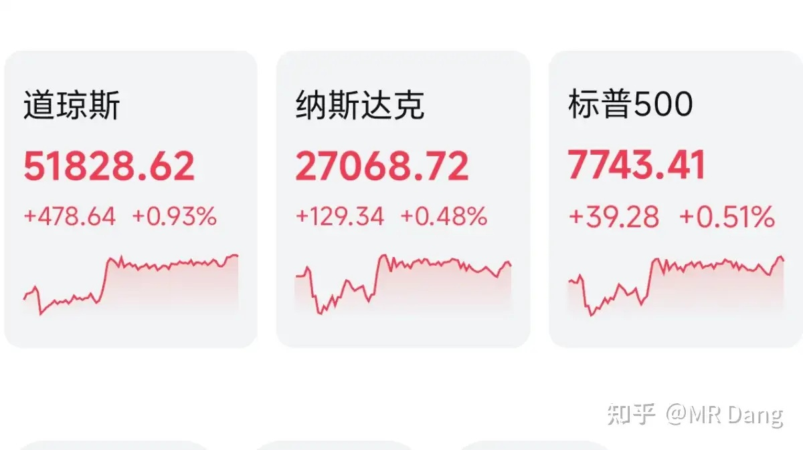

# 如何看待2026年9月28日A股市场行情？

---

**发布时间**: 2026-09-28 07:30  |  **原文链接**: https://www.zhihu.com/question/2083940973940417085/answer/2087806269495178062  |  **点赞数**: 153 人赞同

**作者信息**: MR Dang | 证券从业资格证持证人

---

## 正文内容

### 大家假期愉快啊，先把中秋假期期间发生的事情过一遍

最重要的就是达成了八点共识，具体哪八个，感兴趣的可以找原文。

其中对资本市场影响比较大的就是300亿美元对等降税安排。

这里的300亿美元不是指300亿美元的关税，而是300亿交易额，大约占两边贸易总额的5%左右。

比例不是特别高，但是具有信号意义，起码释放了两边不会擦枪走火的预期。

至于品类的话，咱们对美优惠的可能是农产品，海鲜，木头，化妆品，医疗器械之类的。

美对咱们优惠的可能是小家电，玩具，服装，鞋子这类生活用品。

对这些行业算小利好，可能会增加出口额。为什么是小利好呢，因为300亿美元对应的降低的关税可能也就是四五十亿左右。

---

### 央行

央行在上个交易日结束后开了三季度例会。

很多投资者看这种新闻通稿看的一头雾水，觉得很多语言又空又大，不知道葫芦里卖的到底是什么药。

其实主要看区别，也就是和二季度的通稿对比一下，找一找哪里不同。

我找到的最大的区别就是以前的表述是“加大逆周期和跨周期调节力度”，而最新的表述只剩下了“加大逆周期调节力度”。

“跨周期调节”的表述没了。

什么信号呢？

跨周期的意思就是要往长远的看，不能只看当下。

去掉跨周期就意味着短期目标优先，先把眼前的事情处理好。

“综合运用并适时调整货币政策工具”，这个表述是新增的，和以往的区别是加入了“适时调整”的表述。

总的看下来，个人觉得降准降息还是存在可能性的，拭目以待吧。

---

### 美伊局势

中秋假期期间美伊这边又踢了几个来回球。

上周五伊朗提了个7天开通霍尔木兹海峡的想法，把球踢给了懂王。

懂王看了下协议，觉得接受不了，就直接拒绝了，把球又踢回来了。

然后就是图中的新闻，伊朗昨天把西大在海峡里的水中设备给诱捕上来了。

这是普通侦查装备。

两边都在说要谈判，但是开出的条件都不像有诚意的样子。

倒是海峡目前靠近阿曼一侧的航线已经有点打通了，有机构统计目前的运油量已经恢复到战前的6成以上了。

伊朗手里的筹码越来越少了。

---

### 光模块

假期期间西大的议员又在搞事情了，提了个议案，点名了几家咱们的企业，要排除出涉及他们那边安全的领域。

目前只是提案，还没审议，也没形成文件。

---

### 机器人

外媒报道特斯拉近几个月将Optimus人形机器人的产量提高了大约十倍。

消息人士透露，其生产线正面临机器人灵巧手，自动化设备和供应商限制等问题。

相比身体，腿部来说，灵巧手的门槛似乎更高，而且灵巧手有是生产力的，这也是我个人一直比较看好的人形机器人方向。

---

### 大宗商品

有色整体波动不大，铜铝等工业金属表现稍好。

原油来来回回有各种消息影响，最后的结果是变化不大。

A50期指看不出太明显的趋势。

美长债收益率一路走高，成了悬在头顶的一把利刃。

外围市场：

### 上周四美股如图

纳指纳米红，其他指数都绿了。

### 上周五美股如图

三大股指都涨了，道指领涨，苹果创新高。

趁着大A休市，又涨了一点。

不过咱们这边的话，上周五其实港股没休市，走出了自己特色的行情，恒科距离年内新低最近的时候只剩半个点。

---

上个交易日个人组合净值回撤一个点，银行没动，资源绿两个半点，消费绿近两个点，电网也是近两个点。

这属于比较添堵的行情了，4300多家企业回调，只有1100多家上涨，市场中位数是跌了1.7%左右。

节前效应明显，人心涣散，溃不成军。

---

### 本周前瞻

1，本周是国庆节前最后一个交易周，只有三个交易日。

2，今天统计局公布工业企业利润数据，这个数据我比较看重，指导性还是可以的。

3，周三公布咱们这边的制造业PMI，这是放假前国内最后一个宏观数据了。

4，周四公布西大初请失业金人数。

5，周五公布西大非农数据。

这是假期期间最重要的宏观数据，到时候收假回来是挨打还是吃肉，可能还是要看非农的脸色。

---

### 一个喜欢保护韭菜的博主，希望大家少少踩坑，多多赚钱！！！

> [!comment]- 点击展开评论
>
> | 用户 | 时间 | 内容 |
> | :--- | :--- | :--- |
> | 莱迪mimi |  | 美股趁着大A休市，又涨了一点。不过咱们这边的话，走出了自己特色的行情，恒科距离年内新低最近的时候只剩半个点。 督导这有点绷不住[大哭] |
> | &nbsp;&nbsp;&nbsp;&nbsp;MR Dang |  | [感谢] |
> | 潇夏 |  | 大家十一还有米消费吗？[大哭][大哭][大哭] |
> | 落渊 |  | 节前被抱头挨打，节后继续抱头挨打[大哭][大哭] |
> | 自由人 |  | 节前被揍麻了 |
> | &nbsp;&nbsp;&nbsp;&nbsp;MR Dang |  | [感谢] |
> | &nbsp;&nbsp;&nbsp;&nbsp;养鹅下蛋 |  | 节后继续揍 |
> | &nbsp;&nbsp;&nbsp;&nbsp;11119999 |  | 节后继续后 |
> | &nbsp;&nbsp;&nbsp;&nbsp;自由人 |  | 确实[捂脸] |
> | 在人间 |  | 这月亏麻了，亏了十几个， |
> | 开心的张同学 |  | 今天跌得好，恐慌盘一出，大资金必然进场，科技牛又回来了！ |
> | 在人间 |  | 月初买了小云，亏15个点了。唉。还有垃圾主动基金。 |
> | 沧海飞尘 |  | dang大的电网设备拿的哪几个啊[蹲] |
> | 守常 |  | 绿油油的[感谢] |

---

*本文件从 MR Dang 知乎页面转载*

**作者**: MR Dang  
**链接**: https://www.zhihu.com/question/2083940973940417085/answer/2087806269495178062  
**来源**: 知乎

*著作权归作者所有。商业转载请联系作者获得授权，非商业转载请注明出处。*

---

## 相关阅读

- [[20260924-如何看待2026年9月24日A股市场行情？|上一篇：如何看待2026年9月24日A股市场行情？]]
- [[20260929-如何看待2026年9月29日A股行情？|下一篇：如何看待2026年9月29日A股行情？]]
