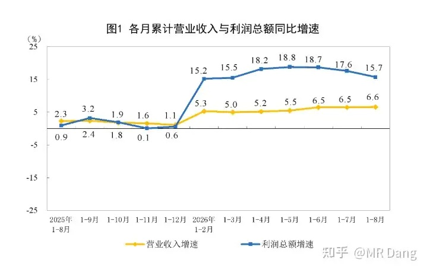
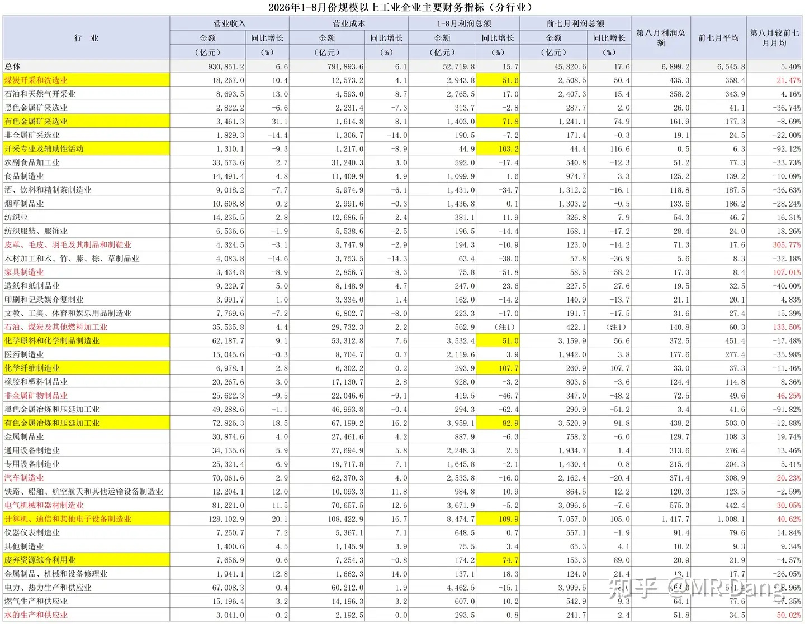
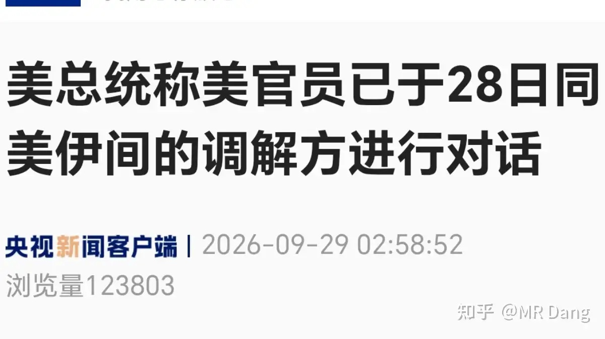
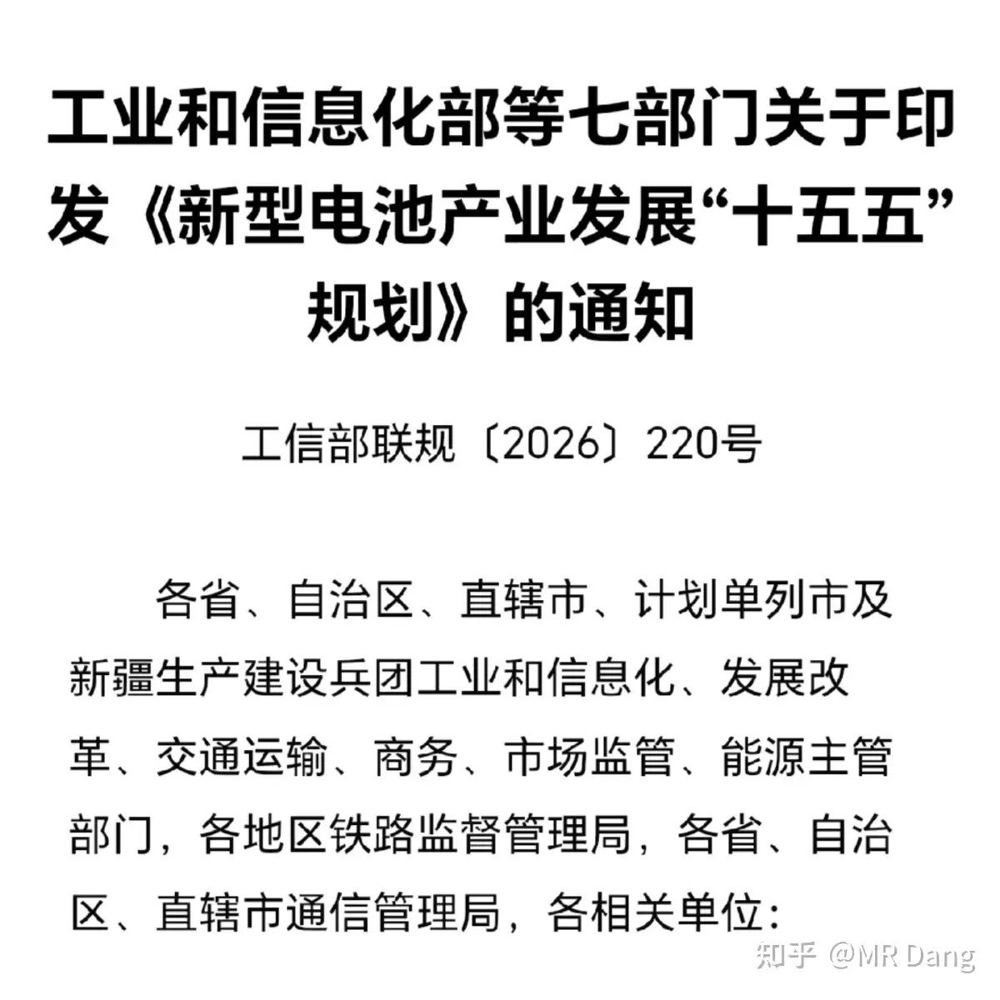
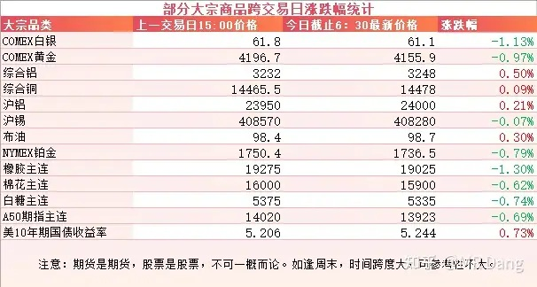
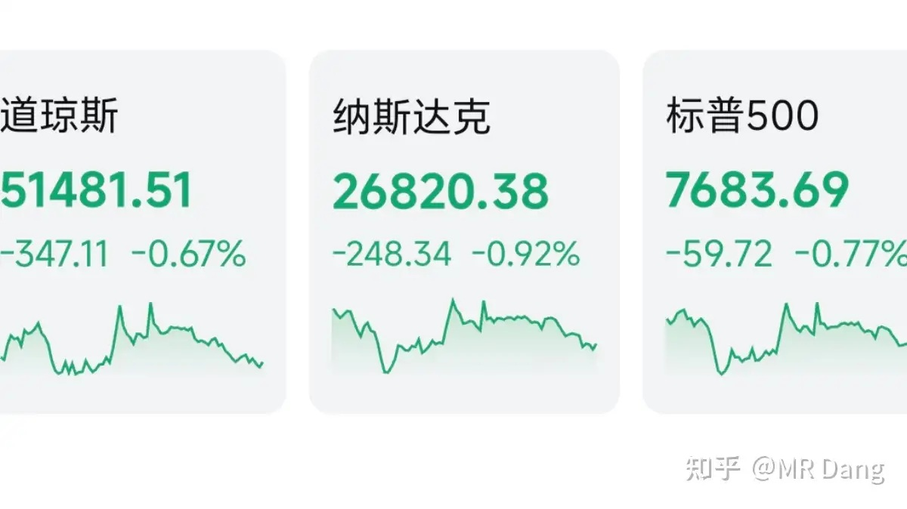

# 如何看待2026年9月29日A股行情？

---

**发布时间**: 2026-09-29 07:30  |  **原文链接**: https://www.zhihu.com/question/2087616611108796117/answer/2088168676486799806  |  **点赞数**: 146 人赞同

**作者信息**: MR Dang | 证券从业资格证持证人

---

## 正文内容

### 先从昨天的统计局数据说起

工业企业利润数据显示前8个月整体营收增速6.6%，利润总额增速15.7%。

看图就能看出来八月单月的利润数据没有太超预期的点，增速有些许回落。

### 分行业数据如下

还是老办法，前8个月同比增速高的行业用黄底表示，第8月环比增速高的用红字表示。

黄底红字的就是同环比数据都不错的行业，仅有两个，煤炭和电子设备制造业。

电子设备制造业单月就有1400多亿，占了全部行业的两成以上，说明咱们经济转型还是很成功的，大有可为啊。

表格里的黑色金属利润依然承压，显示部分钢铁企业已经亏损。

有色的话，分两块，一块是采选，一块是加工。

采选和加工的同比增速都是七八十个点，还行。

环比采选较前面月均回落8个点左右，加工是回落了12个点左右。

比较上个月的话，采选7月利润总额是166亿，8月利润总额是162亿。

加工7月利润总额是411亿，8月利润总额是438亿。

都还行，谈不上最景气，相对来说还是挣钱的。

---

### 美伊局势

懂王称西大已经在昨天和美伊间的调解方进行了对话。

此前还有一家媒体引用知情人士的消息称懂王打算放宽对伊朗的制裁，被懂王辟谣了。

---

### 电池十五五

昨天下午有关部门发布了一个新型电池十五五规划。

其中最让我在意的是新一代电池的表述：

“前瞻布局新型碱金属离子电池、多价离子电池、金属－空气/硫电池、多功能复合材料结构电池、核电池等新一代电池体系。”

这里面提到的，就是未来的方向，投资电池的话可以研究研究。

碱金属离子电池，应该指的是钠电池和钾电池之类的，其中钠电池是目前商业进度最快的，对锂电池有很大的替代效应。它的特点是便宜，理论成本低。

多价离子电池，可能指的是镁，锌，铝，钙电池，目前进度都比较慢。它的特点是理论能量密度高，缺点是电荷密度大，在电池里跑得慢，也就是所谓的扩散动力学比较差。

金属-空气/硫电池，理论上用金属做负极，空气里的氧气做正极，理论能量密度极高，但是这玩意儿听着就科幻，难度太高了。

多功能复合材料电池，就是让碳纤维一边当结构件，一边当电池。比如造车的时候，碳纤维车架，本身就是电池，又硬又轻又有电，目前可能只存在于实验室里。

核电池就不用解释了，听着就是硬科技。

这些电池和目前的锂电池相比，要么理论能量密度高的多，要么理论成本低的多，性能和成本必须占一个，否则没有研究的价值。

我个人觉得还是钠电池比较现实一些，未来这个方向是电池企业的必争之地。

当然锂电池依然是主角，规划里表示2030年要初步实现全固态电池规模化应用，这里对全固态电池也是利好。

---

### 大宗商品

金已经不知不觉跌破4200美元的关口了，不过大多数是昨天盘中跌的，盘后跌的不算多。

工业金属铜铝锡之类的还凑合，正常波动范围。

农产品都在回调。

美长债收益率涨的比股票都快，十年期5.24了都，说实在的，就这个收益率，放在国内的环境下能被抢疯。

A50期指看着不太妙。

希望是大A在给大家准备惊喜，等明天节前最后一天的时候发个红包给所有投资者，然后大家都高高兴兴的出去消费。。。。

### 外围市场

美三大股指回调，纳指领跌，科技股走弱，只有英伟达因为回购力度增加，表现相对较好。

行业上医药，能源等防御板块相对抗跌，其他行业表现不佳。

不过也有好消息，昨晚的中概股表现还不错。

---

昨天个人组合净值回撤一个多点，银行绿大半个点，资源绿两个，电网绿四个半，消费基本打平。

电网这个，昨天早报里说的光模块提案发酵以后带着整个光板块跳水，电网里权重高的部分企业和光有些关系，然后就一起跳了。

被按在电椅上硬控了一整天。

还好消费没有落井下石，不然就是雪上加霜了。

整个市场上4500多家下跌，800多家上涨，市场中位数大概是跌了近两个点左右。

也不算安慰吧，昨天亏两个点以内的都算不错了，市场如此，如之奈何。

---

### 一个喜欢保护韭菜的博主，希望大家少少踩坑，多多赚钱！！！

> [!comment]- 点击展开评论
>
> | 用户 | 时间 | 内容 |
> | :--- | :--- | :--- |
> | Na2S2O3 |  | 上层管理者也是人，人就逃脱不了人性的弱点，就免不了既要又要的贪婪。就说量化，既想稳定市场逐步上涨，又舍不得量化那天量的手续费和印花税，总觉得敲一敲量化，量化就会听话地按照他们的路线走。然而量化是来做什么的？是来极致赚钱的，至于市场秩序？它不需要关心，它只要赚钱，不计后果地赚钱。忽略量化的本质，指望它能抛弃其作为资本的吸血本质，服从指挥棒，就像给老虎喂带肉味的菜叶，指望它从此不再吃肉一样可笑。 |
> | &nbsp;&nbsp;&nbsp;&nbsp;MR Dang |  | [感谢] |
> | &nbsp;&nbsp;&nbsp;&nbsp;真晝 |  | 所以最后还是竭泽而渔[大笑] |
> | &nbsp;&nbsp;&nbsp;&nbsp;lion |  | 可持续性竭泽而渔[doge] |
> | 落叶无伤 |  | 早[感谢]，高高兴兴去消费？向来跌起来快，涨起来慢[捂脸]，难不成两天反包这根大阴吗 |
> | &nbsp;&nbsp;&nbsp;&nbsp;MR Dang |  | [感谢] |
> | 玉书 |  | 国庆注定在家吃泡面，消费不了一点 |
> | &nbsp;&nbsp;&nbsp;&nbsp;MR Dang |  | [感谢] |
> | &nbsp;&nbsp;&nbsp;&nbsp;轻如微尘 |  | 只能做空实体经济了，我要双赢，赢麻，赢学 |
> | 二细刘肉面 |  | 银行这个位置挺香了我觉得[感谢] |
> | william |  | 今天又是一碗面 |
> | &nbsp;&nbsp;&nbsp;&nbsp;MR Dang |  | [感谢] |
> | 你跺你也麻 |  | 早，希望国庆前发个红包 [爱] |
> | &nbsp;&nbsp;&nbsp;&nbsp;MR Dang |  | [感谢] |
> | 无为 |  | [感谢]早 |
> | &nbsp;&nbsp;&nbsp;&nbsp;MR Dang |  | [感谢] |
> | 我是一颗桃子吖 |  | 早[感谢] |
> | &nbsp;&nbsp;&nbsp;&nbsp;MR Dang |  | [感谢]早啊 |
> | 晨雾 |  | [感谢][感谢][感谢] |
> | &nbsp;&nbsp;&nbsp;&nbsp;MR Dang |  | [感谢] |
> | 刘建军儿 |  | [感谢] |
> | &nbsp;&nbsp;&nbsp;&nbsp;MR Dang |  | [感谢] |

---

*本文件从 MR Dang 知乎页面转载*

**作者**: MR Dang  
**链接**: https://www.zhihu.com/question/2087616611108796117/answer/2088168676486799806  
**来源**: 知乎

*著作权归作者所有。商业转载请联系作者获得授权，非商业转载请注明出处。*

---

## 相关阅读

- [[20260928-如何看待2026年9月28日A股市场行情？|上一篇：如何看待2026年9月28日A股市场行情？]]
- [[20260930-如何看待2026年9月30日A股市场行情？|下一篇：如何看待2026年9月30日A股市场行情？]]
