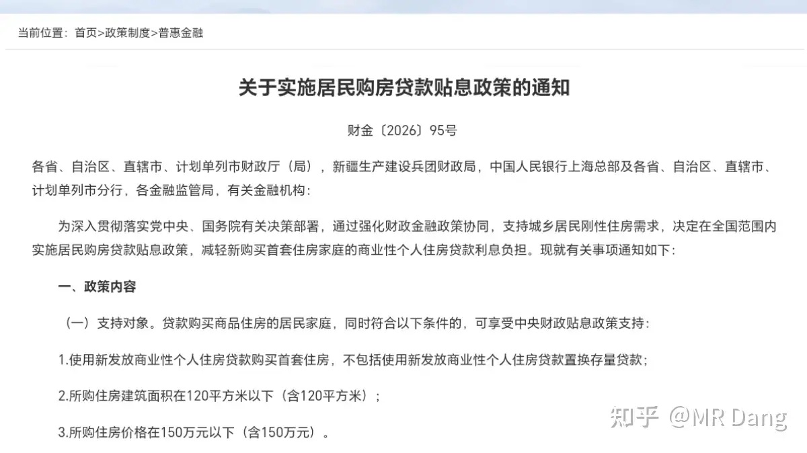
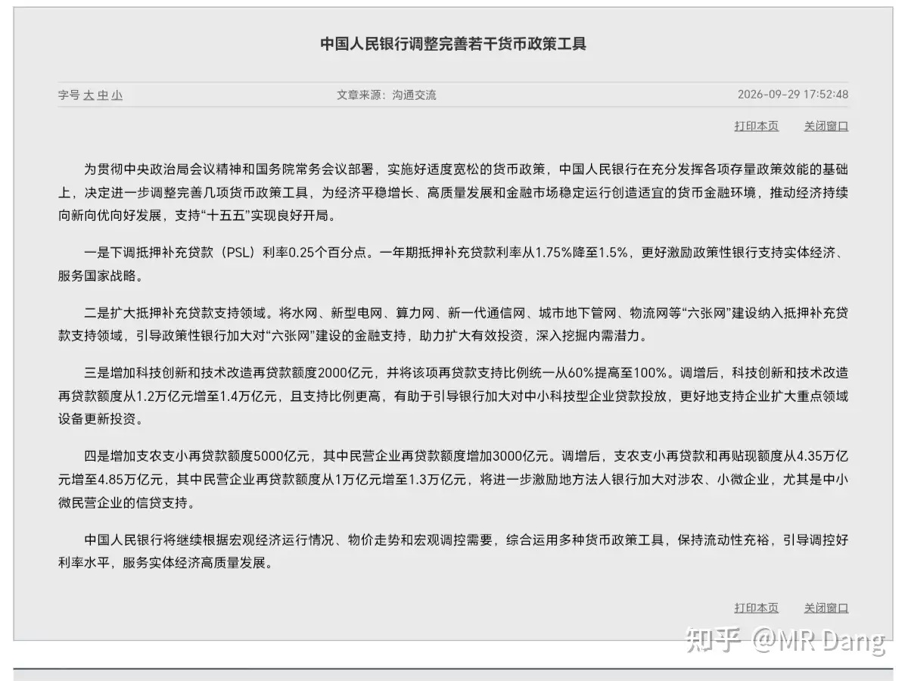
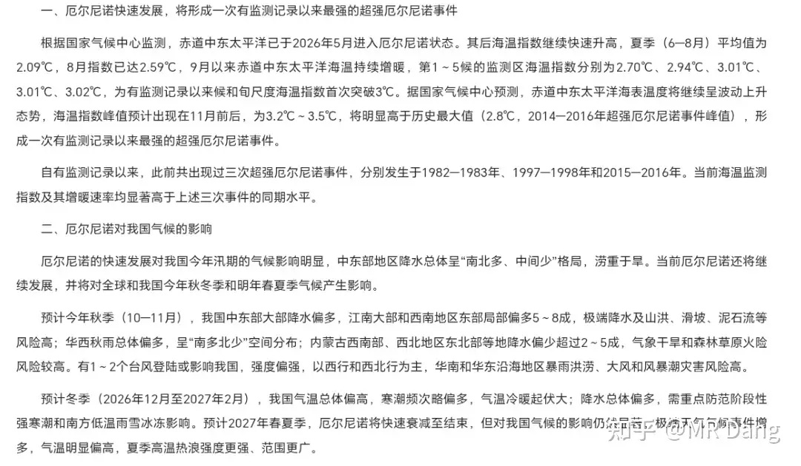
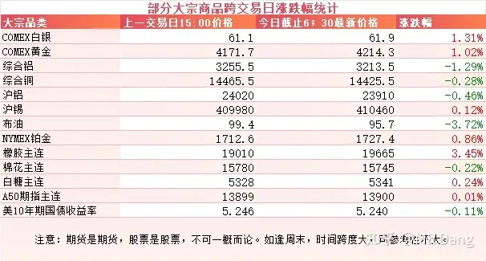
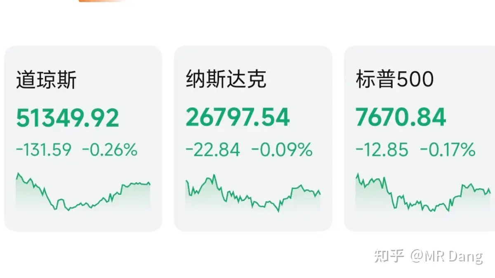

# 如何看待2026年9月30日A股市场行情？

---

**发布时间**: 2026-09-30 07:30  |  **原文链接**: https://www.zhihu.com/question/2085392130088900460/answer/2088531048846069993  |  **点赞数**: 161 人赞同

**作者信息**: MR Dang | 证券从业资格证持证人

---

## 正文内容

### 今天的头条必须是贴息

昨天下午有关部门发布了《关于实施居民购房贷款贴息政策的通知》。

我看了下通知原文和后面的答记者问，感觉这真的是个非常有诚意的政策。

诚意体现在哪里呢？

覆盖面特别大，二手房和新房都可以，要求也不算苛刻，同时不超过120平和150万的新增首套房即可。

可享受的贷款金额设置在了100万。

力度也相当大，贴息1个点，相当于利息的三分之一了。

而且手续简单，就正常办商业贷款的时候授权银行就行了。

十一立即实施，动作迅速。

“应贴尽贴，不设上限”的表述也是说的掷地有声。

当然有机构测算过，最后可能的投入是每年两百亿这个量级。

测算逻辑是2026年按揭发放额大约是3.03万亿，用3.7万亿还款额加上净增额负的6700多亿得到这个数字。

其中首套占比九成，2.73万亿，贴息1%，就是270亿左右。

150万以下占比65%，算下来是177亿左右。

考虑到可能带来的增量，大概就是两百亿这个量级。

我个人觉得这个政策肯定是超预期的，真金白银两百亿，不是什么虚头巴脑的。

利好的话，潜在的购房者，房企，银行，还有二手房卖家，都是最直接的受益者。

从房价和面积来说，主要是惠及刚需类型的客户。

但是如果能盘活刚需需求，那一些置换的人群可以快速回笼资金，整个地产的流动性增加了，对大家都是好事。

---

### 降息

PSL是央行向三家政策性银行提供的资金。

所以这不是全面降息，而是定向精准的降息。

降低三大政策性银行的负债成本，让更多的资金流向下游领域，激活咱们的经济活力，这也是好事。

PSL本次新增了六张网领域，而之前主要是保障性住房，城中村改造，平急两用等领域。

所以利好六张网，地产等行业。

再结合上面的政策，可以看出这是一套精准降息+普惠贴息的组合拳。

诚意十足，力度空前。

---

### 厄尔尼诺

昨天气象局开了个新闻发布会，介绍有关天气的情况。

会上的表述是“形成一次有监测记录以来最强的超强厄尔尼诺事件”。

预测对咱们的影响是秋季降水偏多，冬季气温偏高，明年夏天高温强度更强，范围更广。

现在资本市场已经把厄尔尼诺都炒了一遍了，农产品预期打的也挺满的。

但是我看到说明年就夏天要更热，范围还广，我又想到了一个方向，感觉等一个机会蹲一蹲也不是不行，相信专家的预测。

这类事件的中短期投资，或者说成投机也行，我个人的看法就是在没溢价的时候，可以找个机会蹲一蹲，相当于免费的期权。

一旦有溢价了，就要谨慎了，不要为了别人的期权买单。

---

### 大宗商品

最新对10月加息的押注概率从7成左右降低到了5成。

有色里黄金白银等贵金属大概涨了一个点，铜铝有半个点左右的回调。

原油回到了95美元左右。

天然橡胶大幅上涨三个多点，逼近两万大关 。

### 外围市场

美三大股指集体回调，道指领跌。

板块上半导体，软件应用，商业航天等表现相对较好。

目前全球史上最贵的IPO，Anthropic的招股书泄露了，装了波大的。

财务数据就不多说了，2025年的很难看，亏了420亿绿票子。

这个是会计处理，其中340亿都是可转换融资工具带来的亏损，并不是真的亏损。

其他业务虽然也亏，但这家公司发展速度特别快，一天一个样，不能用过去的财务数据去衡量现在的估值。

为什么说装了波大的呢？招股公告书里写业务的只有40多页。

而一直写Ai发展太快，给人类带来灭顶之灾的风险，就这玩意儿硬是写了80页。

目前他家的Claude是公认的断档第一，所以这就像每次考第一的学霸在获奖感言里对学习方法避而不谈。

反而大谈特谈要怎么减少学习时间，加强体育锻炼，追剧的正确姿势，游戏里如何打出华丽的操作。

另外Anthropic史上最贵的头衔也有可能维持不了多久，OpenAi目前投前估值已经来到了1.4万亿，经常性收入达到了700亿，到时候真上市的时候说不定还要抢一抢这个“史上最贵”。

---

昨天个人组合净值回血半个点，银行红半个，资源红一个半，消费基本打平，电网微绿。

还不错，现在要求比较低了，只想着大A不要给国庆添堵就行了。

市场情绪也还行，涨多跌少，普遍回血。

行业上，地产比较强。

所谓春江水暖鸭先知，咱们这边的鸭还真不少的嘞。

---

### 一个喜欢保护韭菜的博主，希望大家少少踩坑，多多赚钱！！！

> [!comment]- 点击展开评论
>
> | 用户 | 时间 | 内容 |
> | :--- | :--- | :--- |
> | 言不可弥 |  | 贴息只贴五年，而且早几天就有地产开始动了，消息有人提前知道 |
> | &nbsp;&nbsp;&nbsp;&nbsp;MR Dang |  | [感谢] |
> | &nbsp;&nbsp;&nbsp;&nbsp;玉书 |  | 对，我就说奇怪，万科连板。所以，散户怎么跟机构玩 |
> | hejzhb |  | 估计是蹲煤电光伏吧，看价位那就是光伏发电[大笑] |
> | &nbsp;&nbsp;&nbsp;&nbsp;MR Dang |  | [感谢] |
> | 总是被捂嘴 |  | 除了科技股，其它行业在十月份可能会涨一波，因为地产开始上涨行情了。 地产兴，百业旺！ 事实证明，左棍们宣扬的人定胜天已经失败了，客观规律终究不可违背，发展经济，最后还是要回到房地产和外贸上面来。 |
> | &nbsp;&nbsp;&nbsp;&nbsp;MR Dang |  | [感谢] |
> | 八思八 |  | 这怎么超预期的 我可以负责任的说100万房子买了一年最少亏10左右 然后补贴你5万 。这账很简单，非必要非刀架脖子绝不买房。 |
> | 没什么不同 |  | [感谢] |
> | &nbsp;&nbsp;&nbsp;&nbsp;MR Dang |  | [感谢] |
> | wuyuzhuo2004 |  | 这也叫力度很大？完全把一线城市的房产排除在外 |
> | wuma |  | 绿的全被我买上了 |
> | Amanda |  | 继续蹲电力？ |
> | &nbsp;&nbsp;&nbsp;&nbsp;MR Dang |  | [感谢] |
> |  |  | 已从上个月开始定投绿色电力基金🫡 |
> | 奶片 |  | 哥早，假期愉快[感谢] |
> | &nbsp;&nbsp;&nbsp;&nbsp;MR Dang |  | [感谢]早，假期愉快 |

---

*本文件从 MR Dang 知乎页面转载*

**作者**: MR Dang  
**链接**: https://www.zhihu.com/question/2085392130088900460/answer/2088531048846069993  
**来源**: 知乎

*著作权归作者所有。商业转载请联系作者获得授权，非商业转载请注明出处。*

---

## 相关阅读

- [[20260929-如何看待2026年9月29日A股行情？|上一篇：如何看待2026年9月29日A股行情？]]
