# 如何看待2026年10月8日A股行情？

---

**发布时间**: 2026-10-08 07:30  |  **原文链接**: https://www.zhihu.com/question/2088626701974640096/answer/2091430156107831024  |  **点赞数**: 215 人赞同

**作者信息**: MR Dang | 证券从业资格证持证人

---

## 正文内容

### 还是老样子，把国庆长假期间发生的事情捋一捋

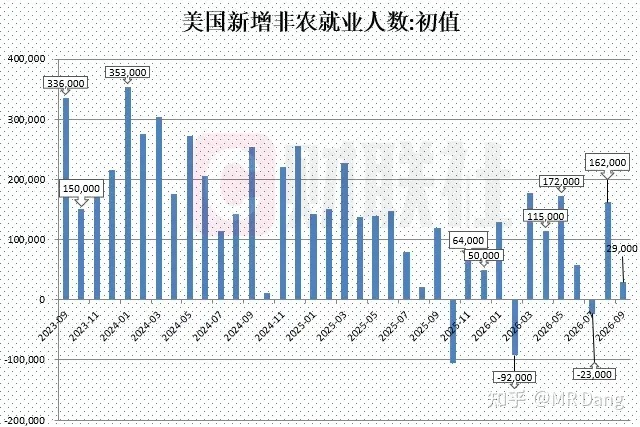

长假期间最重要的宏观数据就是西大的非农就业数据。

9月新增非农就业人数2.9万人，大幅低于预期的9万人和前值16.2万人。

同时还把7月和8月的数据合计下修了6万。

也就是说，9月新增的还没有下修的多。

数据公布后，市场对十月加息的押注概率从50%以上降低到了20%以下。

外围市场也在这一数据的刺激下接连创出新高。

---

### 央行买金

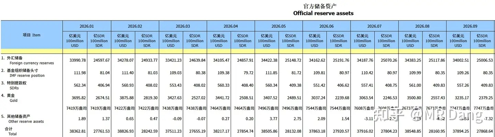

有关部门公布了最新的外汇储备，9月末黄金储备7747万盎司，9月单月买金74万盎司，大概是23吨。

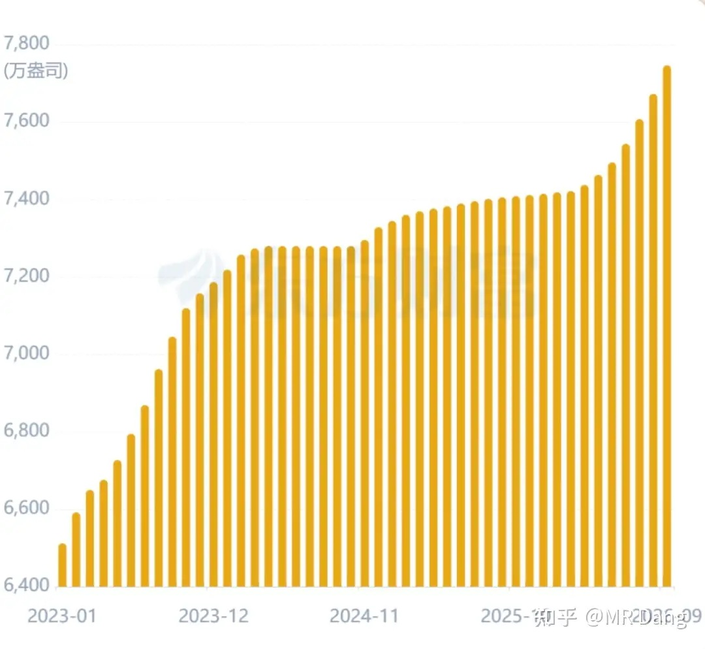

这个买金速度在年内已经是新高了，在历史上大概能排进前10名左右。

央行常态化增持黄金力度最大的单月是2022年11月，峰值单月增持103万盎司。

---

### 美元指数

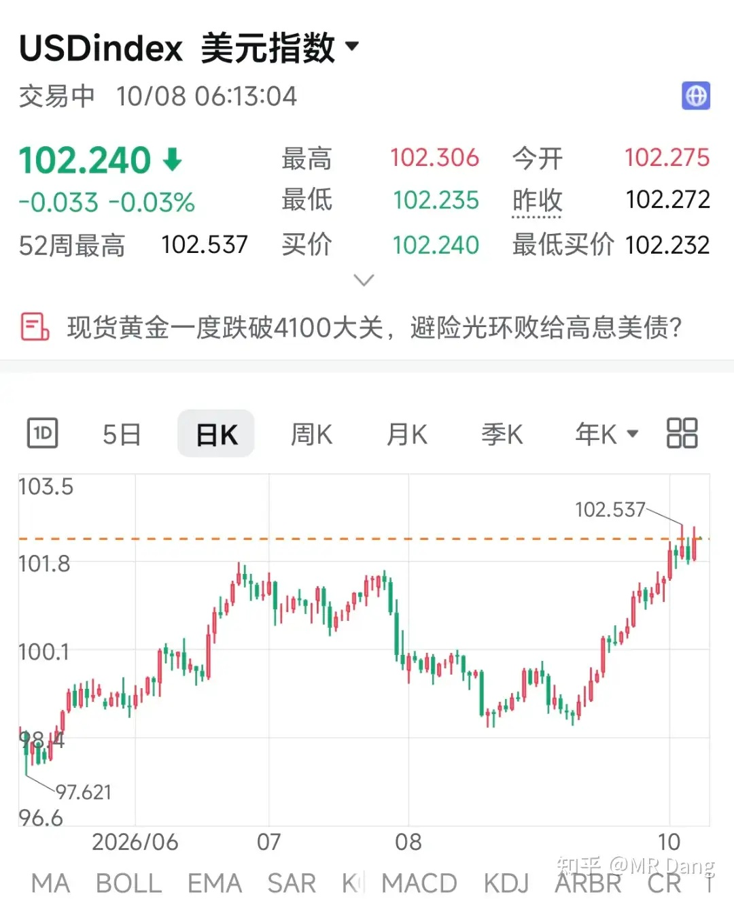

长假期间美元指数势如破竹，创了近期新高。

---

### 美伊局势

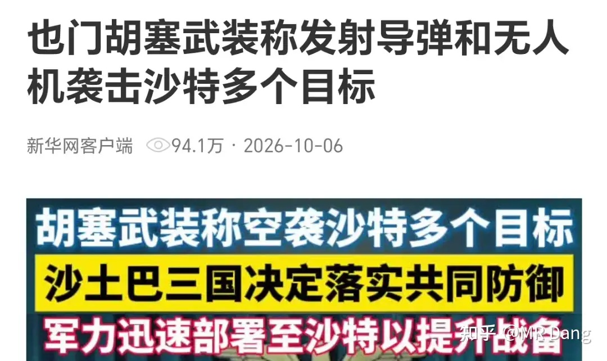

假期期间美伊之间还在打嘴炮，没太多新的变量。

但是沙特和胡赛打的有来有回，主要袭击了利雅得机场和石油设施等目标。

原油价格相较于节前有一些涨幅。

---

### 恒科指数

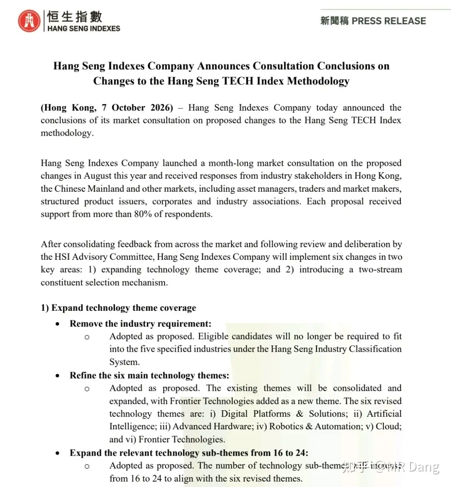

恒科扩容，从30只到50只的咨询文件已经通过。

最终成分股名单要到11月20日检讨结果敲定，12月7日生效。

目前根据新的扩容规则，机构猜测了一些企业名单。

假期期间港股也是有正常开市的，结果就是恒科在假期期间创了新低，整体比节前大概回调了一个多点吧。

---

### TMR

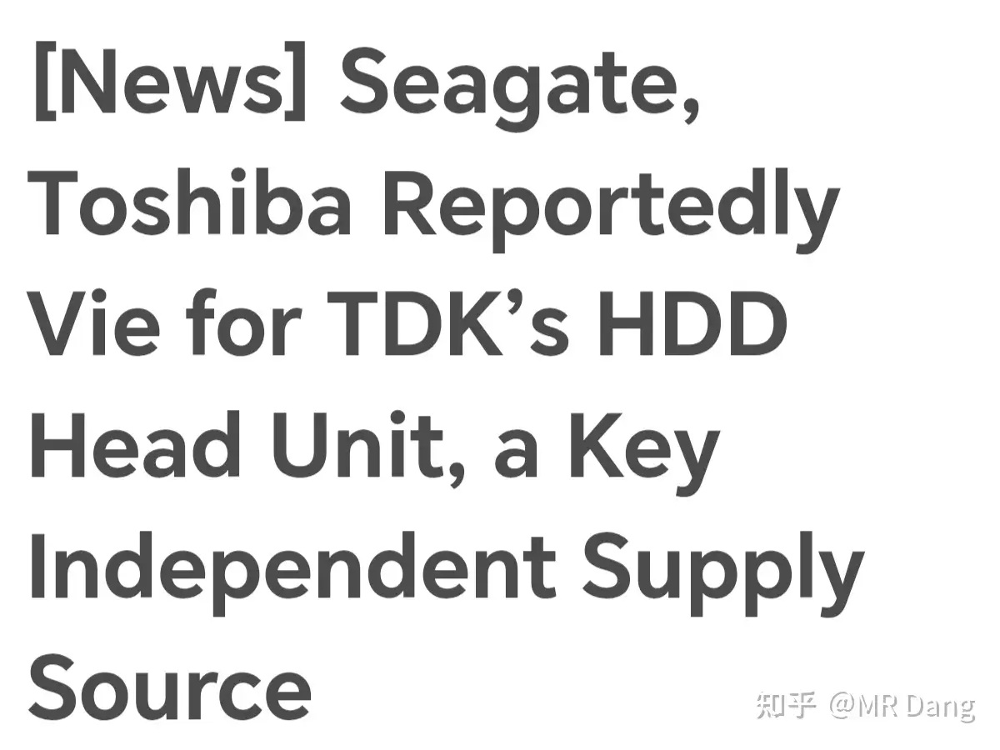

最近外媒报道东芝和希捷在竞购TDK的磁头业务。

Ai产业推动了市场对SSD固态硬盘的需求，但是SSD成本还是高，所以在低端领域就用HDD机械硬盘替代。

HDD产业里技术门槛最高的就是磁头TMR，是机械硬盘行业的霍尔木兹海峡。

TDK是TMR行业的龙头，这次被争抢了。

咱们这边也有一家擦边的上市企业，主要是给希捷做代工的。

HDD本身不算什么高科技，东芝也在推动扩产，所以目前整体预期并不是很好，假期期间存储板块整体表现不佳。

---

### 反倾销

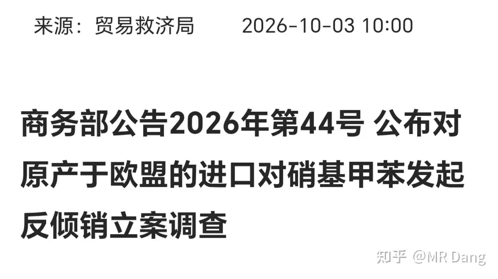

有关部门公布对原产于欧盟的进口对硝基甲苯发起反倾销立案调查。

此前有类似先例的化工品是甲苯胺，这次对硝基甲苯是首次提到。

对硝基甲苯的上游是甲苯，下游是染料等行业。

反倾销可能会造成价格上涨，对有产能的企业算利好，对下游企业会造成成本压力。

---

### 影视业

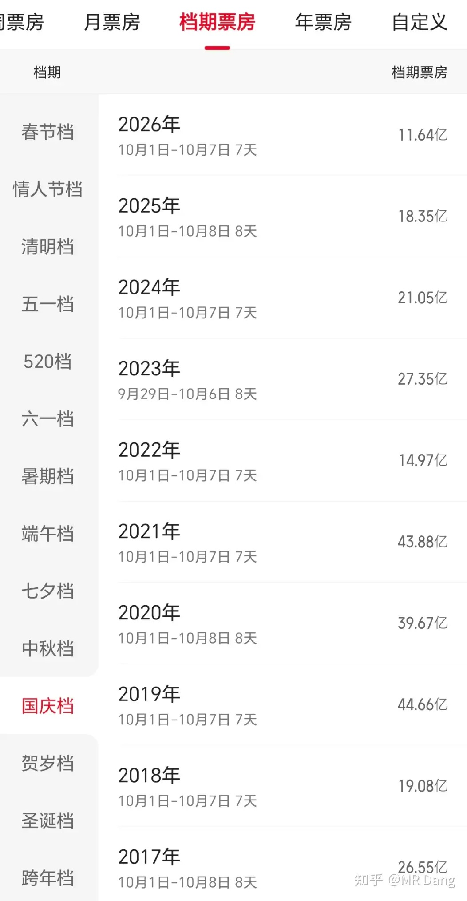

今年国庆期间，电影票房拉了坨大的。

上面这图是近十年来的国庆档票房数据，今年的数据创了十年新低。

我个人对电影的看法就是春节档提前埋伏投机倒把还凑合，长期投资价值几乎为0。

---

### Ai

国庆期间克劳德钓鱼执法又封了一大批大陆用户的账号，这次主要是针对此前挂了梯子的漏网之鱼。

克劳德是头部Ai企业里对东大敌意最大的。

---

### 诺奖

2026年诺贝尔物理学奖诞生了，今年的诺奖又颁给了中微子领域。

这是诞生诺奖最多的领域之一，是由中微子本身的物理特性决定的。

国内对标的是江门中微子实验JUNO，也有一些上市企业参与。

但是这类营收占比非常小，而且没什么持续性，商业价值是很小的，投资价值也是。

前沿科学考虑的就不止是经济价值。

化奖也公布了，两个人一起分享，主要是有关手性自我放大的机制，偏基础研究，距离应用层面比较远。

---

### 大宗商品

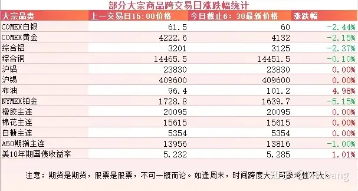

假期期间的原油价格有所上涨，大概是四五个点的涨幅。

有色整体偏弱，有两个点左右的回调。

农产品国内的没开市，不过看国外的话，涨幅还是可观的。

A50期指看着情绪不佳，今天得放低预期。。。。。。

美十年期和三十年期国债收益率都在假期期间创了近25年以来的新高。

### 外围市场

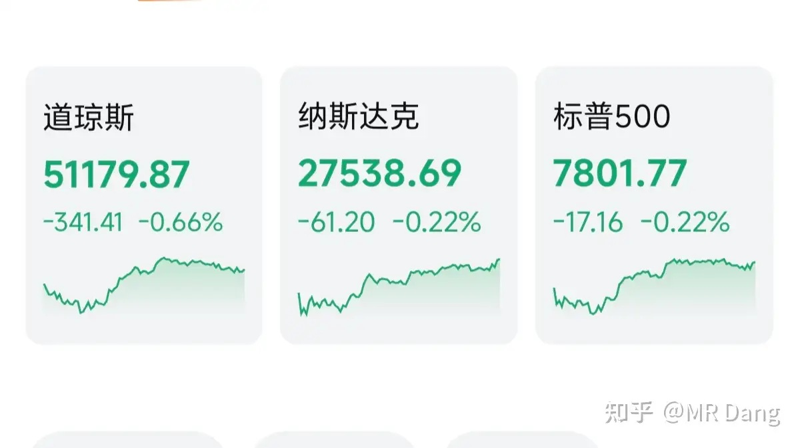

昨晚美三大股指回调。

是在近期创了历史新高的基础上。

假期趁着大A休市，独自涨了两三个点左右。

巴西股市也在假期期间有大幅上涨，累计涨了十个点左右，创历史新高。

原因是在巴西的大选首轮投票中，前总统博索纳罗之子小博索纳罗意外领先，比现任总统得票率更高。

小博索纳罗的主张里有减税和私有化等资本市场更爱听的故事。

总结就是美，日，巴西都在假期期间高歌猛进，而恒科创年内新低。

---

上个交易日个人组合净值回血一个点，银行红一个点，资源红半个，消费红两个，电网纳米绿。

假期前最后一个交易日还是给了点体面的，让人愉快的度过了七天。

---

### 本周前瞻

1.本周仅两个交易日。

2.今天公布西大周初请失业金人数。

---

### 一个喜欢保护韭菜的博主，希望大家少少踩坑，多多赚钱！！！

> [!comment]- 点击展开评论
>
> | 用户 | 时间 | 内容 |
> | :--- | :--- | :--- |
> | 我是一颗桃子吖 |  | 早[感谢] |
> | &nbsp;&nbsp;&nbsp;&nbsp;MR Dang |  | [感谢]早 |
> | 木子一 |  | [感谢] |
> | &nbsp;&nbsp;&nbsp;&nbsp;MR Dang |  | [感谢] |
> | 地坤 |  | 看来没人关注原油运价，裂解差上天。 |
> | 以小沫 |  | 早[感谢] |
> | &nbsp;&nbsp;&nbsp;&nbsp;MR Dang |  | [感谢] |
> | 回声 |  | 早[感谢] |
> | &nbsp;&nbsp;&nbsp;&nbsp;MR Dang |  | [感谢] |
> | 秋也 |  | [感谢] |
> | &nbsp;&nbsp;&nbsp;&nbsp;MR Dang |  | [感谢] |
> | 街对面的老李 |  | 2027春节档除了流浪地球三，别的还没定档啊 |
> | &nbsp;&nbsp;&nbsp;&nbsp;MR Dang |  | [感谢] |
> | 敏锐蜗牛 |  | [感谢] |
> | &nbsp;&nbsp;&nbsp;&nbsp;MR Dang |  | [感谢] |
> | 狄仁杰 |  | [感谢][感谢] |
> | &nbsp;&nbsp;&nbsp;&nbsp;MR Dang |  | [感谢] |
> | 帅小伙 |  | 老师早[感谢] |
> | &nbsp;&nbsp;&nbsp;&nbsp;MR Dang |  | [感谢] |

---

*本文件从 MR Dang 知乎页面转载*

**作者**: MR Dang  
**链接**: https://www.zhihu.com/question/2088626701974640096/answer/2091430156107831024  
**来源**: 知乎

*著作权归作者所有。商业转载请联系作者获得授权，非商业转载请注明出处。*

---

## 相关阅读

- [[20260930-如何看待2026年9月30日A股市场行情？|上一篇：如何看待2026年9月30日A股市场行情？]]
- [[20261009-如何看待2026年10月9日A股行情？|下一篇：如何看待2026年10月9日A股行情？]]
