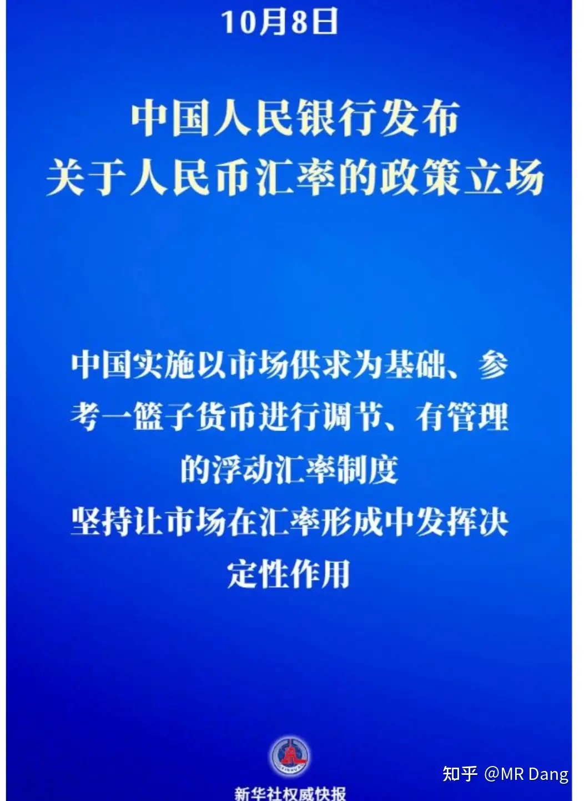
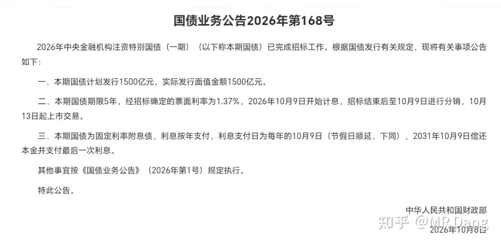
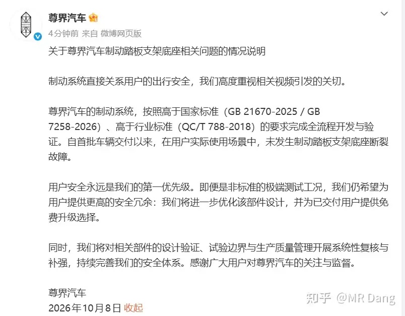
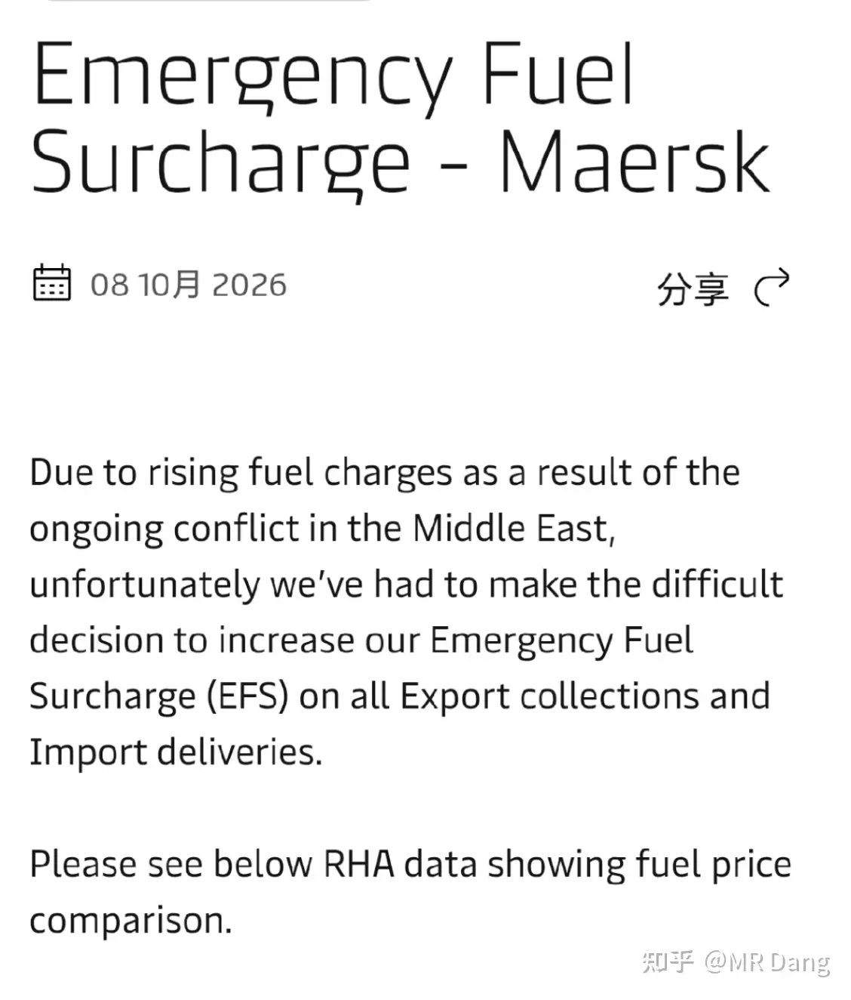
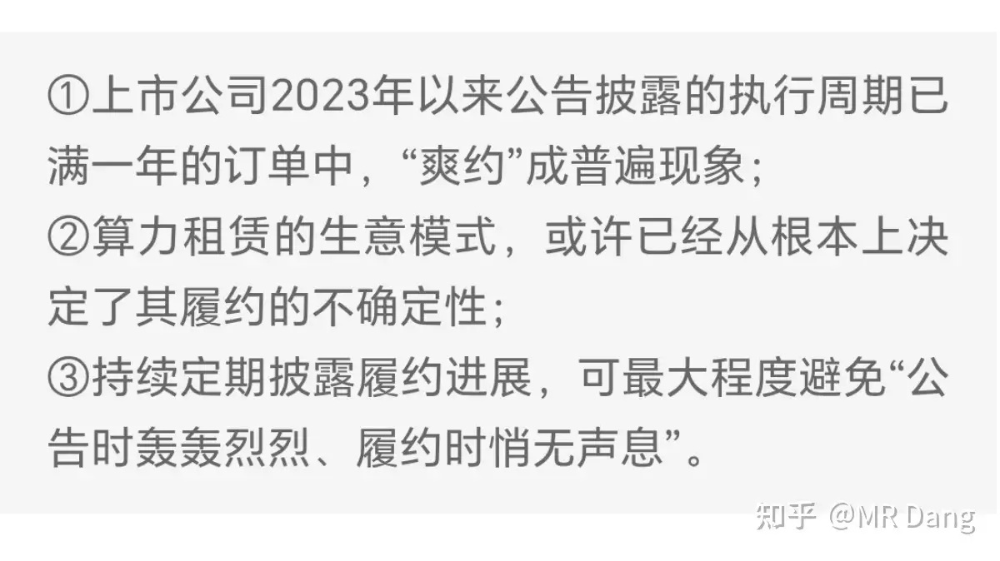
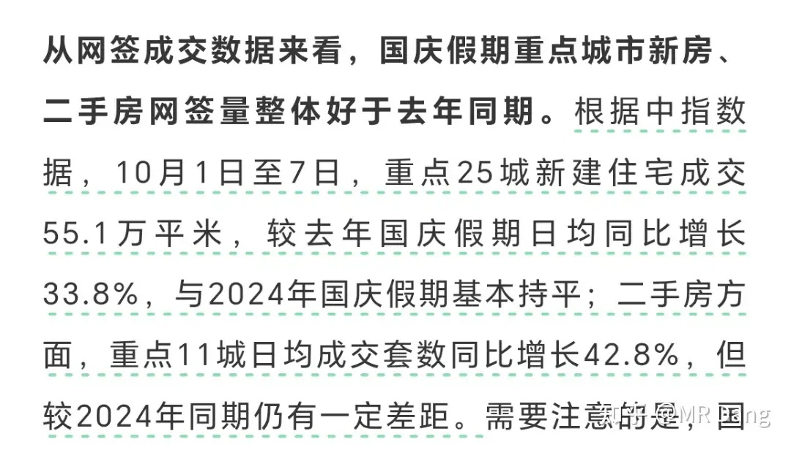
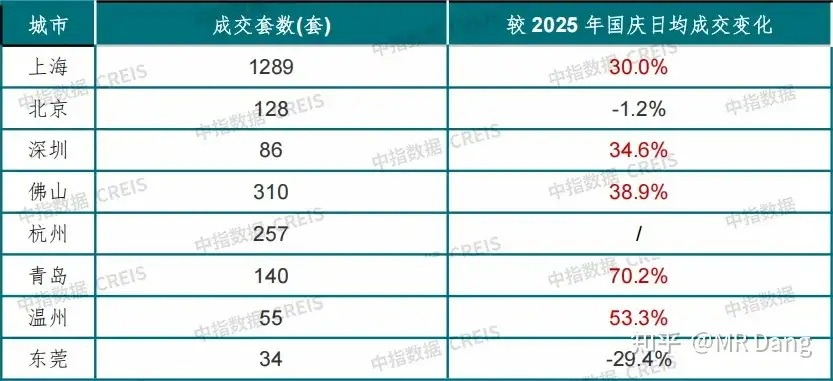
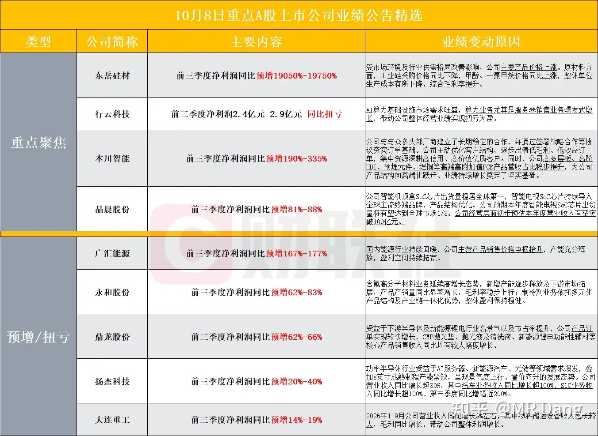
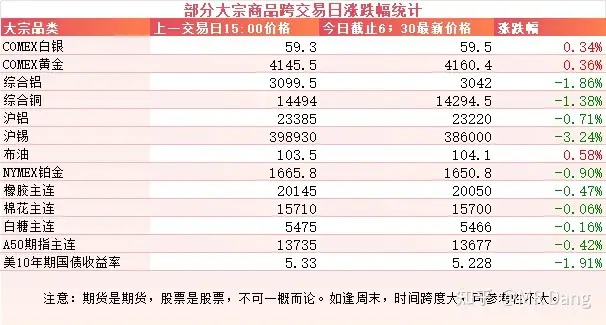
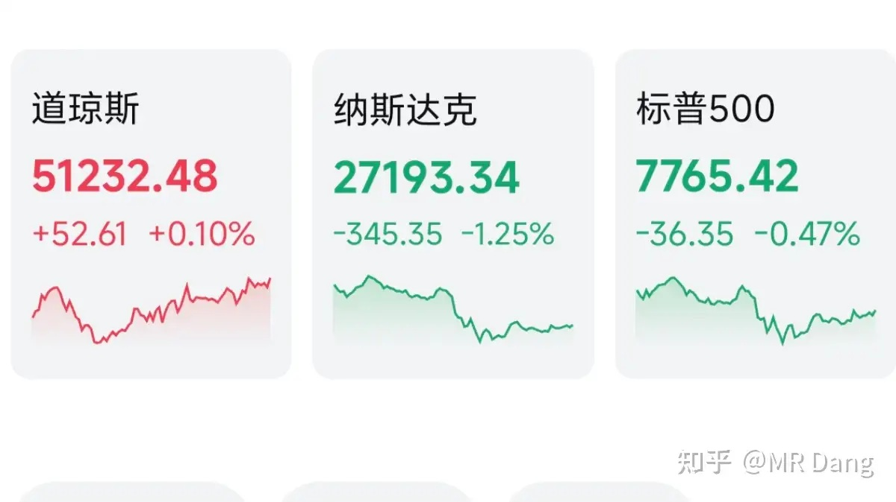

# 如何看待2026年10月9日A股行情？

---

**发布时间**: 2026-10-09 07:30  |  **原文链接**: https://www.zhihu.com/question/2091037849982350382/answer/2091792558104040836  |  **点赞数**: 180 人赞同

**作者信息**: MR Dang | 证券从业资格证持证人

---

## 正文内容

### 央行对汇率进行表态

最重要的是阐述了不预设汇率目标水平，不干预汇率长期趋势，保持汇率弹性和双向浮动。

最近外媒攻击咱们的货币购买力被低估，这算是一次系统性的回应。

很多人关注的点是这个表态到底是偏向升值还是贬值？

其实按照字面意思，是要交给市场，但是不能暴涨暴跌，没有明显的倾向。

---

### 债券招标

很多人看的一头雾水的，可能过了一个长假，之前发的公告都忘。

这个就是之前几个大银行发公告进行定增的后续。

当时不是说财政部出钱么，钱的来源就是特别国债，现在落地。

总共是3000亿，一期1500亿，期限是5年。

最让我感到意外的是中标利率仅1.37%，这个利率已经是历史最低水平。

其实可以跟紧上面的步伐的，有关部门目前就是在借便宜钱，然后增持银行，特别是大行，这是明牌中的明牌。

各方面来说，财政部肯定是比普通投资者站的更高，看的更远的。

怎么说呢，行动是比语言更有力量的。

---

### 汽车业

昨天懂车帝有一个测试对资本市场影响挺大的。

据懂车帝视频，在本月初进行的测试中，连续购买3台全新尊界V800，进行100km/h-0紧急制动测试，3台车刹车踏板支架均断裂。

资本市场用脚投票，里面的小股东已经为此买单。

### 事发后品牌也进行了回应

大体意思是设计没问题，除了测试视频里没断过。

但是出于用户安全考虑，让用户更安全，依然提供了免费升级。

这个品牌本来定位就是高端，有钱人都是比较惜命的，无论最后结果是什么，怀疑的种子一旦种下，对销量都会有影响。

---

### 航运

航运巨头马士基发了个公告，要提高所有出口提货和进口派送业务的紧急燃油附加费EFS至20%。

马士基是行业里老大，它一涨价，其他企业很可能跟进。

这对其他行业都算利空，和油价上涨是差不多的逻辑，会推高通胀水平。

对油运航运行业当然是利好。

---

### 算力

某媒体发了一篇有关算力的专题报道《算力大单上演纸面狂欢》，大意是算力行业的订单猫腻大，上市企业签的合同，爽约概率大于履约概率。

话里话外的意思就是有些企业发签约的公告是为了二级市场割韭菜的。

在资本市场这不算什么新的故事，只不过算力合同动不动几十亿上百亿确实有些离谱，有些公司本身市值几十亿，签个合同都能上百亿。

---

### 房地产

中指研究院发布了今年国庆的成交数据，从部分样本城市来看，新房二手房比去年同期有所好转。

还有个信号是近期一线城市核心区域的房租也稳住了，作为一项资产来说，这是很重要的定价锚。

---

### 三季报业绩预告

三季报开始陆续披露，本月的最后一周会迎来披露高峰，大部分企业和人一样，多多少少都有些拖延症。

---

### 大宗商品

有色整体波动不大，贵金属表现较好，工业金属有少许回调，其中锡的价格最近波动比较大，最近两个交易日没少跌。

要硬找原因的话，可能是受了算力两个字的影响。

农产品高位震荡，橡胶已经站上两万，这是景气度的分水岭。

世界气象组织发了最新的气候预警，厄尔尼诺要维持到明年二月份左右。

A50期指继续承压。

美债收益率有所回调，这是唯一的好消息。

农产品这块儿，世界气象组织发了最新的气候预警，厄尔尼诺要维持到明年二月份左右。

### 外围市场

美三大股指涨跌不一，纳指领跌，半导体回调。

存储，光模块之类都在跌，Openai的营收被爆出来比此前预期的700亿绿票子少了200亿。

传统行业比较强势，油气能源类的涨幅靠前。

---

昨天个人组合净值回血小半个，银行红大半个，资源纳米绿，消费基本打平，电网绿小半个。

幸福是对比出来的，所以还是很满足的。

市场的话，情绪不佳，收假刚回来就是一个雷霆大比兜直接呼脸上。

创业板指数，深成指以及恒科这三大指数不约而同的创了年内新低。

恒科截止目前年内跌了26%了，这里说的还只是是年内跌幅，如果从高点算起来，40%跌没了，比很多个股波动幅度都大。

整个市场大概是近1700家上涨，另外3700多家下跌，中位数大概是跌了一个点左右。

行业上光模块拖累了指数，又是西大FCC小作文之类的吓跑了资金。

---

### 一个喜欢保护韭菜的博主，希望大家少少踩坑，多多赚钱！！！

> [!comment]- 点击展开评论
>
> | 用户 | 时间 | 内容 |
> | :--- | :--- | :--- |
> | 青仁 |  | 暴跌这么多了 再也不相信了[知乎益蜂] |
> | 旻19 |  | 昨天先拉后砸今天先砸后拉，完犊子了[思考] |
> | keith |  | 今天怎么没发[爱] |
> | 我是一颗桃子吖 |  | 早[感谢] |
> | &nbsp;&nbsp;&nbsp;&nbsp;MR Dang |  | [感谢]早啊 |
> | LEO-A |  | [感谢] |
> | SAM526 |  | [感谢] |
> | &nbsp;&nbsp;&nbsp;&nbsp;MR Dang |  | [感谢] |
> | jincsjin |  | 早 |
> | &nbsp;&nbsp;&nbsp;&nbsp;MR Dang |  | [感谢] |
> | lion |  | [感谢] |
> | &nbsp;&nbsp;&nbsp;&nbsp;MR Dang |  | [感谢] |
> | 小白爬楼梯 |  | [感谢] |
> | &nbsp;&nbsp;&nbsp;&nbsp;MR Dang |  | [感谢] |
> | 要吃泡芙和蛋糕 |  | 老师 锡业你还看好吗[感谢] |

---

*本文件从 MR Dang 知乎页面转载*

**作者**: MR Dang  
**链接**: https://www.zhihu.com/question/2091037849982350382/answer/2091792558104040836  
**来源**: 知乎

*著作权归作者所有。商业转载请联系作者获得授权，非商业转载请注明出处。*

---

## 相关阅读

- [[20260930-如何看待2026年9月30日A股市场行情？|上一篇：如何看待2026年9月30日A股市场行情？]]
- [[20261012-怎么看待2026年10月12日A股市场行情？|下一篇：怎么看待2026年10月12日A股市场行情？]]
