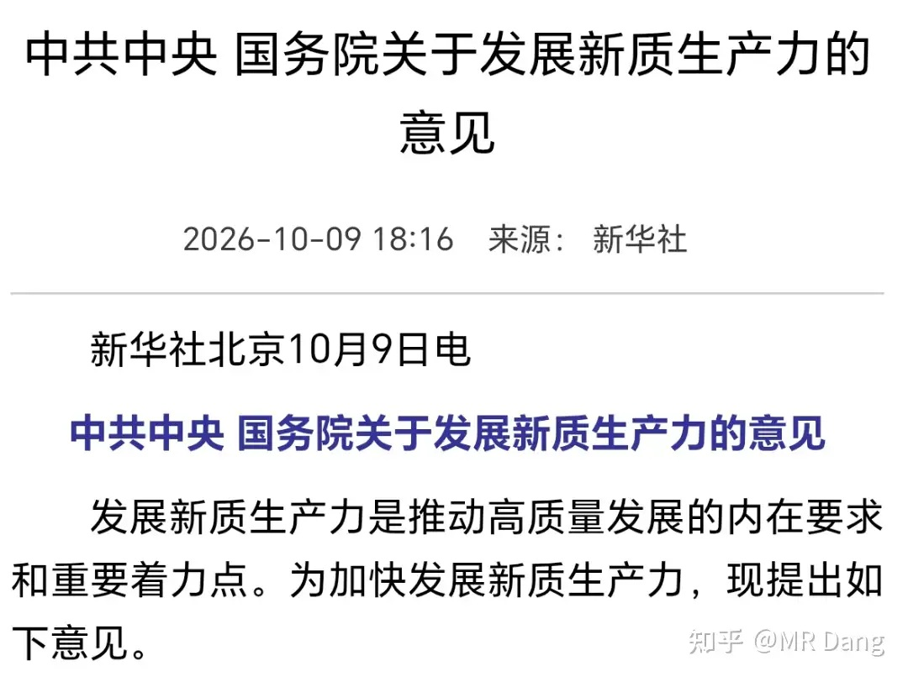
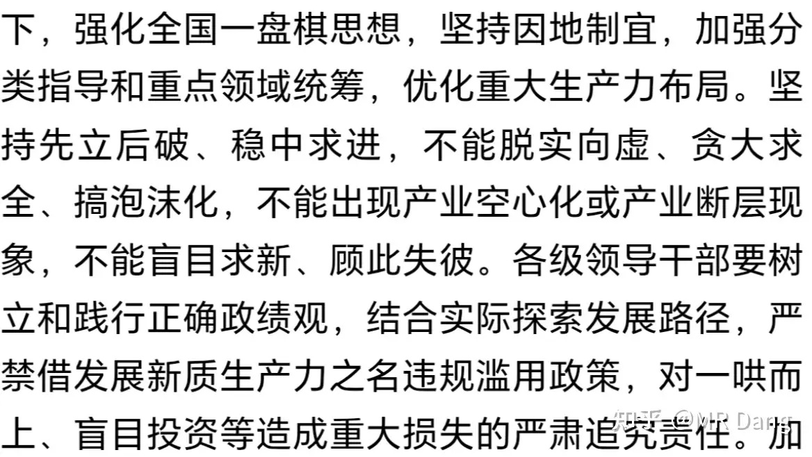
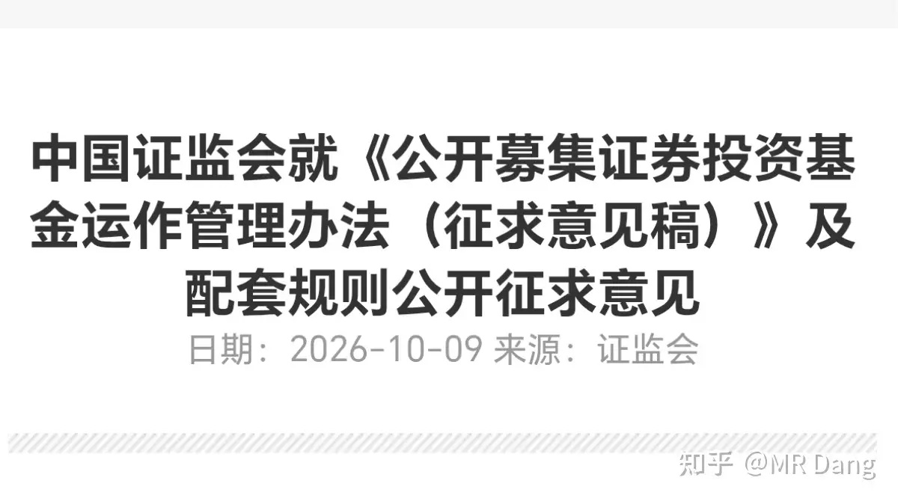
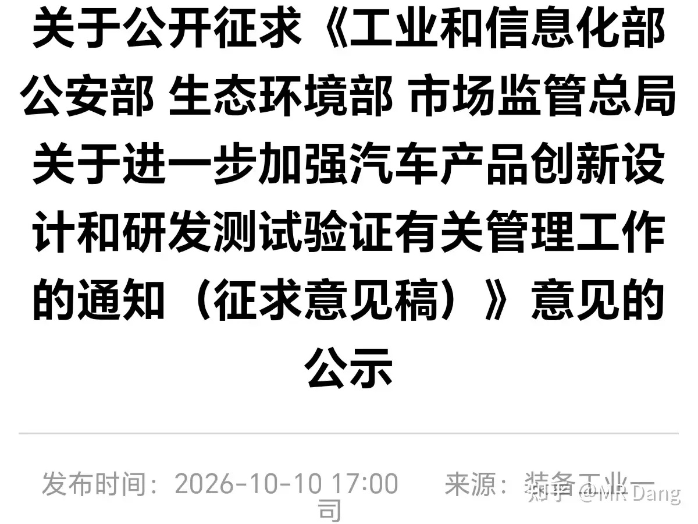
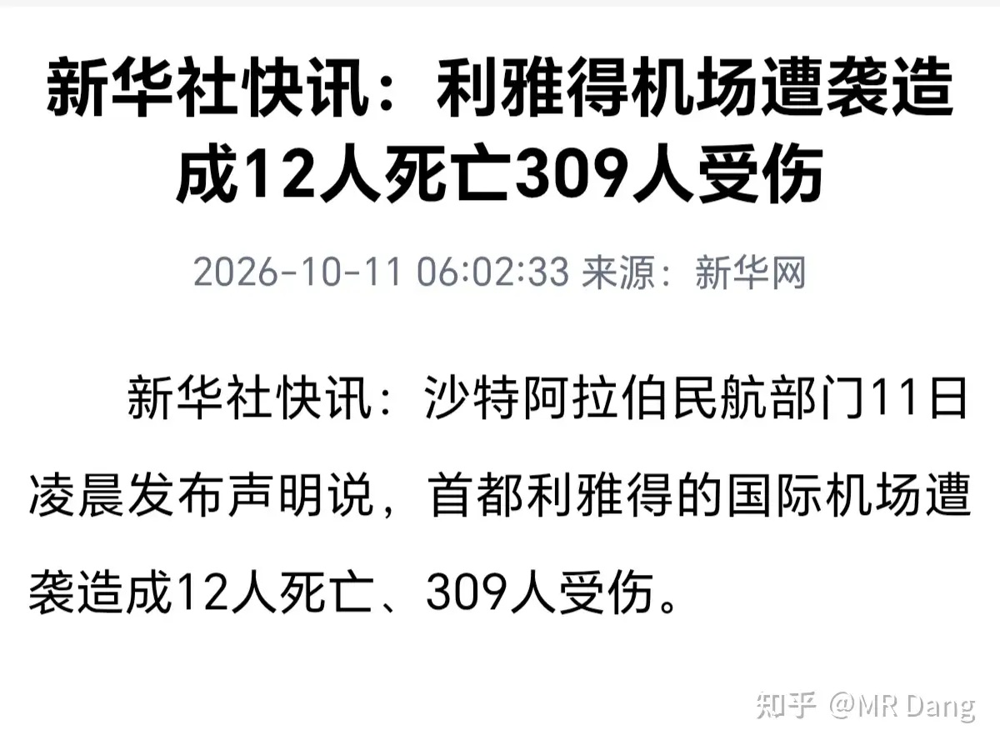
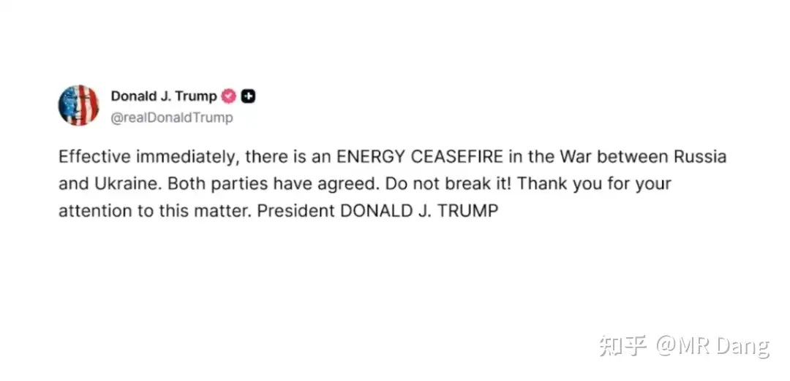
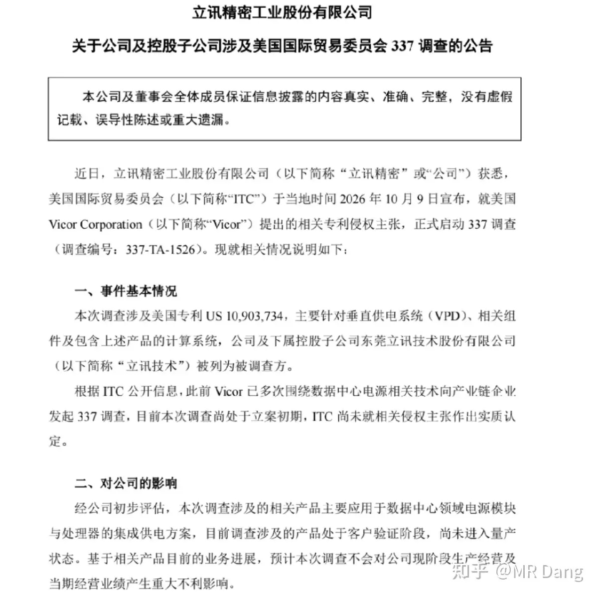
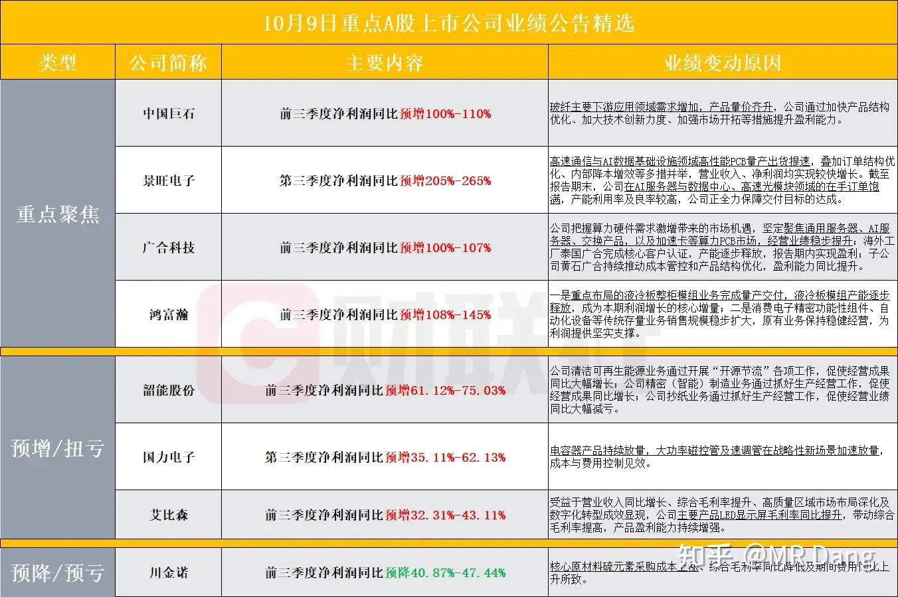
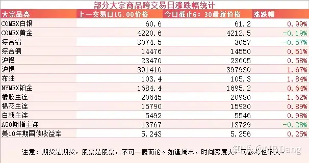
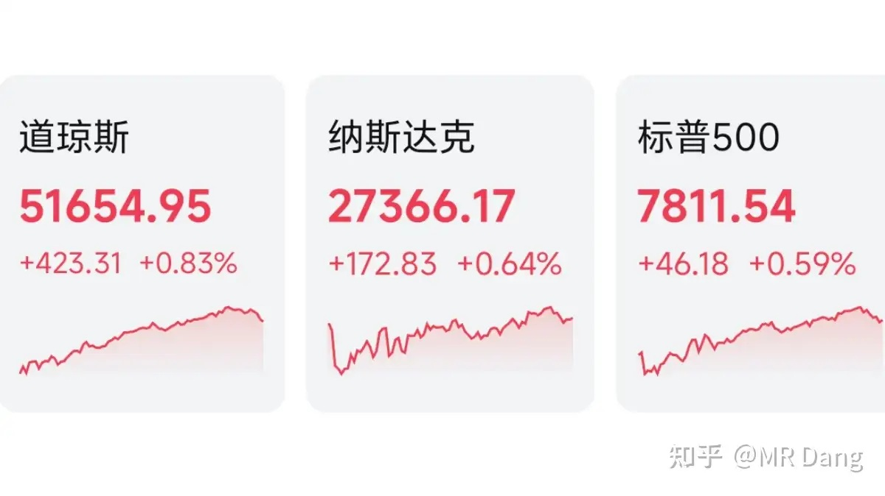

# 怎么看待2026年10月12日A股市场行情？

---

**发布时间**: 2026-10-12 07:30  |  **原文链接**: https://www.zhihu.com/question/2091917341986657362/answer/2092879694978990313  |  **点赞数**: 206 人赞同

**作者信息**: MR Dang | 证券从业资格证持证人

---

## 正文内容

### 周末最大的消息是上面发了一个《关于发展新质生产力的意见》

这种顶层文件，只有看原文才能领略到精髓。

### 我个人的话，最在意的是后面第七部分

措辞很严厉，特别是对一哄而上，盲目投资造成的重大损失严肃追责这种表述相当罕见。

---

### 公募基金

有关部门对公募基金运作管理公开征求意见。

最超预期的是权益类基金门槛从两亿降低到了5000万。

门槛低了，基金就更好发了。

有更多的投资者可以享受大A发展带来的红利了，好事。

我能想到的利空就是网下打新的收益率又要缩水了，因为这个金额和网下打新的门槛很接近，僧多粥少。

---

### 汽车业

有关部门发了一个有关汽车设计的征求意见稿。

其中有三个点比较超市场预期。

第一个是直接禁掉了全隐藏门把手，折叠屏，柔性屏。

第二个是应急手刹等必须配备实体操纵件。

第三个是行驶中禁用零重力和旋转座椅等功能。

其他还有车企宣传时不得使用违反道路交通法规的场景宣传产品功能。

这些针对性还是挺强的，联系最近的热点事件，“速成车”已经成为了行业痛点。

现在有些头部企业提供电车底盘和电池一条龙服务，新成立的品牌买回去套个壳子，装几个座椅，挂个车标，就是一台新车。

---

### 地缘局势

沙特机场遇袭，伤亡人数比较大。

懂王称美国“可能”加入沙特针对胡塞武装的打击行动，“我们将仔细考虑”。

懂王还在俄乌局势上声称两边实现了“能源停火”，也就是互不攻击能源设施。

泽连斯基回应说这对他来说也是一条新闻，后面又改口承认。

大毛这边倒是没回应。

之前懂王在9月份的时候也宣布过一次，不到24小时两边就开始互炸了。

---

### 公告速递

某知名果链企业发布了一则公告，主要内容是其VPD业务被西大调查。

另外还有另一家上市公司也发了类似的公告。

理性的看，VPD业务没有放量，而且和主业完全没关系，实际影响不大。

但是现在比较敏感，特别是企业的商业模式比较依赖西大，这对市场来说是一个不健康的信号。

---

### 部分企业业绩预告情况

---

### 大宗商品

有色整体波动不大，锡略强。

原油有少许涨幅。

农产品里最靓的仔当属橡胶了，又创新高，逼近21000大关。

美债收益率维持高位，A50看着一般。

### 外围市场

上个交易日美三大股指集体上涨，道指领涨。

板块上除了半导体和油气，基本是普涨，有色涨幅靠前。

中概股表现也不错。

---

上个交易日个人组合净值回血大半个点，银行纳米绿，资源红一个多，消费红近三个，电网绿半个。

有时候直接吃糖会显得不甜，但是如果毒打一通，这个时候哪怕嘬一口手指头都是甜的。

上个交易日显然就是这种情况，指数在经历了大落大起以后，会给人一种劫后余生的感觉。

宽基ETF在午后持续放量，一句老乡别走吹响了反攻的号角。

我自己的话，其实有点跷跷板，所以上下午的感受差距不大。

比较出乎我意料的是消费板块，也没什么利好，最近以来表现还挺顽强的。

市场上表现比较好的是电池板块，有机构调研了10月电池厂家的排产计划，同环比增速比较超预期，让市场对上游材料的需求预期有所改观。

---

### 一个喜欢保护韭菜的博主，希望大家少少踩坑，多多赚钱！！！

> [!comment]- 点击展开评论
>
> | 用户 | 时间 | 内容 |
> | :--- | :--- | :--- |
> | 一只狗kenny | 14 小时前 | 有时候直接吃糖会显得不甜，但是如果毒打一通，这个时候哪怕嘬一口手指头都是甜的。[大哭] |
> | &nbsp;&nbsp;&nbsp;&nbsp;MR Dang | 14 小时前 | [感谢] |
> | 鼓龍朱 | 14 小时前 | 上周清掉了科创etf后，今日持仓全红，来看看D佬早闻，择标的建仓 |
> | &nbsp;&nbsp;&nbsp;&nbsp;镜子大师 | 9 小时前 | 真的吗 敢发截图看看？ |
> | 木子一 | 15 小时前 | [感谢] |
> | &nbsp;&nbsp;&nbsp;&nbsp;MR Dang | 15 小时前 | [感谢] |
> | 痴茶姑娘 | 4 小时前 | 已经深套了 |
> | 抱脸虫 | 6 小时前 | 立讯精密还跌吗？ |
> | 18一枝花 | 16 小时前 | [感谢] |
> | &nbsp;&nbsp;&nbsp;&nbsp;MR Dang | 16 小时前 | [感谢] |
> | momo | 15 小时前 | [感谢] |
> | &nbsp;&nbsp;&nbsp;&nbsp;MR Dang | 15 小时前 | [感谢] |
> | 帅小伙 | 15 小时前 | 老师早[感谢] |
> | &nbsp;&nbsp;&nbsp;&nbsp;MR Dang | 15 小时前 | [感谢] |
> | 没什么不同 | 14 小时前 | [感谢] |
> | &nbsp;&nbsp;&nbsp;&nbsp;MR Dang | 14 小时前 | [感谢] |
> | 我是一颗桃子吖 | 15 小时前 | 早[感谢] |
> | &nbsp;&nbsp;&nbsp;&nbsp;MR Dang | 15 小时前 | [感谢]早啊 |

---

*本文件从 MR Dang 知乎页面转载*

**作者**: MR Dang  
**链接**: https://www.zhihu.com/question/2091917341986657362/answer/2092879694978990313  
**来源**: 知乎

*著作权归作者所有。商业转载请联系作者获得授权，非商业转载请注明出处。*

---

## 相关阅读

- [[20261009-如何看待2026年10月9日A股行情？|上一篇：如何看待2026年10月9日A股行情？]]
