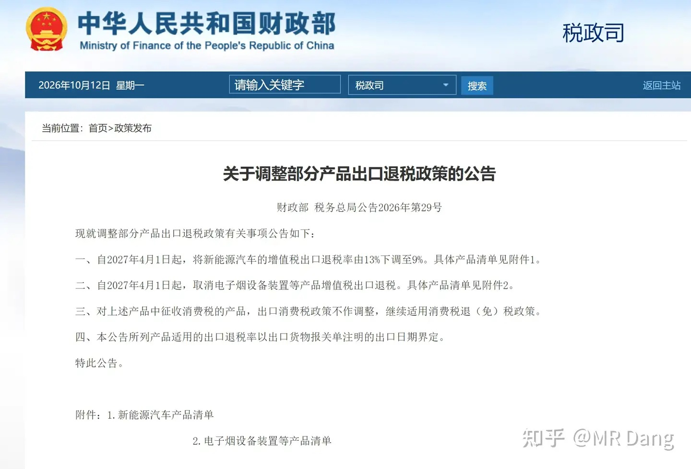
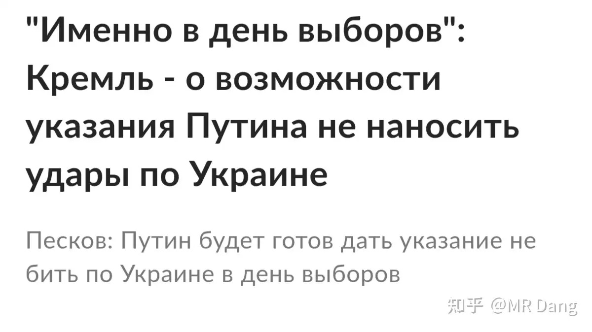
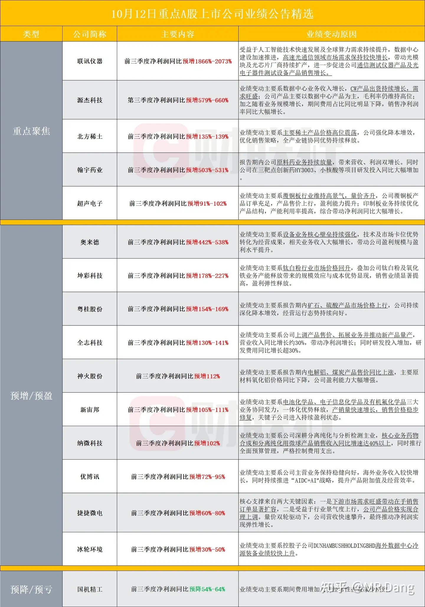
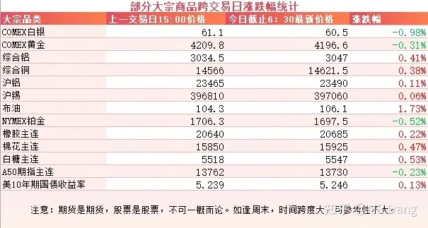
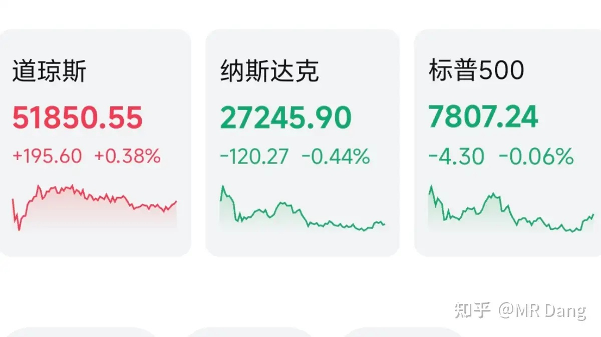

# 如何看待2026年10月13日A股市场行情？

---

**发布时间**: 2026-10-13 07:30  |  **原文链接**: https://www.zhihu.com/question/2087930581933937461/answer/2093242200574510660  |  **点赞数**: 174 人赞同

**作者信息**: MR Dang | 证券从业资格证持证人

---

## 正文内容

### 汽车业

有关部门发布通知，从明年4月1日起，新能源汽车的增值税出口退税率从13%下调到9%。

这对电车企业来说无异于天空一声巨响。

刚开始时补贴退坡，车购税优惠减少，现在增值税出口退税一下又降低了四个点。

昨天乘联会也发布了车企前9个月的数据，电车和油车都不怎么样，经营压力还是不小的。

很容易让人联想到光伏行业的来时路，从产业扶持一路到反内卷，从财政支持一路到承担税务责任。

电车这个行业，短时间内没有反转迹象，应该回避，这个观点说了有一年了，现在依然不变。

唯一好的一方面就是不是立即执行，明年4月1日落地，所以这几个月相当于抢出口的窗口期，可能短期内出口数据反而会好一些。

---

### 俄乌局势

最近泽连喊话大毛，说自己这边准备大选，要大毛进行为期60天的停火。

大毛深思熟虑后同意了大选的想法，不过只给了一天的时间，也就是大选当天。

懂王已经被高油价搞出痛苦面具了，最近一直在施压泽连。

---

### 诺贝尔经济学奖

今年的诺奖颁发给了两个人，这两人的贡献都是搭建了DSGE模型的微观基础，是对凯恩斯经济学的缝缝补补。

两位都是非常学院派的学者，但凡对宏观经济学有了解的投资者应该都有所耳闻。

他们最出名的理论简单点说就是预期比现实更重要，比如人如果对未来预期比较悲观，哪怕现在收入还行，也不会有消费欲望。

换句话说，人在悲观的时候，你政策再怎么刺激，效果也有限，不太容易因为宏观上积极的政策去改变自己的行为模式。

---

### 部分企业三季度业绩预告情况

---

### 大宗商品

有色整体波动不大，贵金属稍微有些弱。

原油有少许涨幅。

农产品挺强的，在高位上震荡。

美债收益率下不来，哈萨克斯坦的央行被美债收益率吸引了，公开表示要降低一部分黄金仓位，换成美债。

A50期指依然承压。。。。感觉这句话已经成每天的固定短语了。

除了表里的商品，昨天碳酸锂跌了个大的，可以用惨不忍睹来形容。

现在供需天平慢慢倾斜，供大于求的迹象越来越明显，钠电池也一直在路上，电车这块需求也让人揪心。

### 外围市场

美三大股指涨跌不一，纳指领跌。

板块上半导体走弱，科技回调。

油气，保险，食品等防御性板块走强。

中概股表现不佳。

---

昨天个人组合净值回血大半个点，银行红近两个点，消费红一个半，资源绿两个半，电网绿近一个半。

非常割裂的一个交易日，有点像鸳鸯火锅一样，泾渭分明，看着自己手里的跷跷板有点哭笑不得。

整个市场有1100多家企业上涨，4300多家企业回调，市场中位数大概是跌了1.7%左右，痛感还是比较强的。

避险和防御成为了大家讨论的热点，所以银行又被市场重视了起来。

科技这边目前最大的问题是，外围涨的时候，科技涨的不多，如果碰到外围大幅度回调，感觉情绪上会有影响。

外围的话，研究机构SemiAnalysis发了一个研究报告，大概意思是英伟达的表外承诺高达5300亿绿票子，比表内的总资产还多。

这里的表外承诺里，有一大半是采购承诺，还有一些担保什么的，是有一些负债性质的。

这从另一方面印证了循环融资的事情，而英伟达是整个科技行情的发动机，如果它的基本面有一些不确定性，可能会动摇整个科技板块的信心。

另外国内的险资在二季度也追高了科技板块，对这种没有股息回报的板块，机构都是有严格的风控的，随着科技板块回落，嗯。。。。。。险资对这部分风险是要出清的。

---

昨天写完以后总觉得哪里不对劲，说不上来，最后多看了几遍，发现本周前瞻给漏了，今天补上：

1，周三公布西大和东大的CPI，都是挺重要的宏观数据。

2，周三公布咱们这边的贸易数据。

3，周四公布西大的初请失业金人数。

4，周四公布咱们这边的用电数据。

5，周四广交会开幕，有重要领导参加。

本次广交会分三期进行，一期主题先进制造，二期主题是品质家居，三期主题是美好生活。

市场相对更关注的还是一期先进制造。

6，周四特斯拉的新车Roadster二代发布，此前已经介绍过了，据传可能会悬浮跳跃之类的。

---

### 一个喜欢保护韭菜的博主，希望大家少少踩坑，多多赚钱！！！

> [!comment]- 点击展开评论
>
> | 用户 | 时间 | 内容 |
> | :--- | :--- | :--- |
> | 金科 |  | [感谢][感谢][感谢]天天吃面，今天连面也没得吃啦 |
> | &nbsp;&nbsp;&nbsp;&nbsp;MR Dang |  | [感谢] |
> | babyQ |  | 这行情。就是钝刀子割肉 |
> | SAM526 |  | [感谢]早 |
> | &nbsp;&nbsp;&nbsp;&nbsp;MR Dang |  | [感谢] |
> | 我是一颗桃子吖 |  | 早[感谢] |
> | &nbsp;&nbsp;&nbsp;&nbsp;MR Dang |  | [感谢]早啊 |
> | 刘建军儿 |  | [感谢] |
> | &nbsp;&nbsp;&nbsp;&nbsp;MR Dang |  | [感谢] |
> | 谶语殇劫 |  | “预期比现实更重要” |
> | 浪里小白马 |  | [感谢][感谢] |
> | &nbsp;&nbsp;&nbsp;&nbsp;MR Dang |  | [感谢] |
> | icing77 |  | [感谢]早…谢谢分享 |
> | &nbsp;&nbsp;&nbsp;&nbsp;MR Dang |  | [感谢] |
> | JopiN Lee |  | 锡好惨[大哭][大哭] |
> | 帅小伙 |  | 老师早[感谢] |
> | &nbsp;&nbsp;&nbsp;&nbsp;MR Dang |  | [感谢]早 |

---

*本文件从 MR Dang 知乎页面转载*

**作者**: MR Dang  
**链接**: https://www.zhihu.com/question/2087930581933937461/answer/2093242200574510660  
**来源**: 知乎

*著作权归作者所有。商业转载请联系作者获得授权，非商业转载请注明出处。*

---

## 相关阅读

- [[20261012-怎么看待2026年10月12日A股市场行情？|上一篇：怎么看待2026年10月12日A股市场行情？]]
- [[20261014-如何看待2026年10月14日A股行情走势？|下一篇：如何看待2026年10月14日A股行情走势？]]
