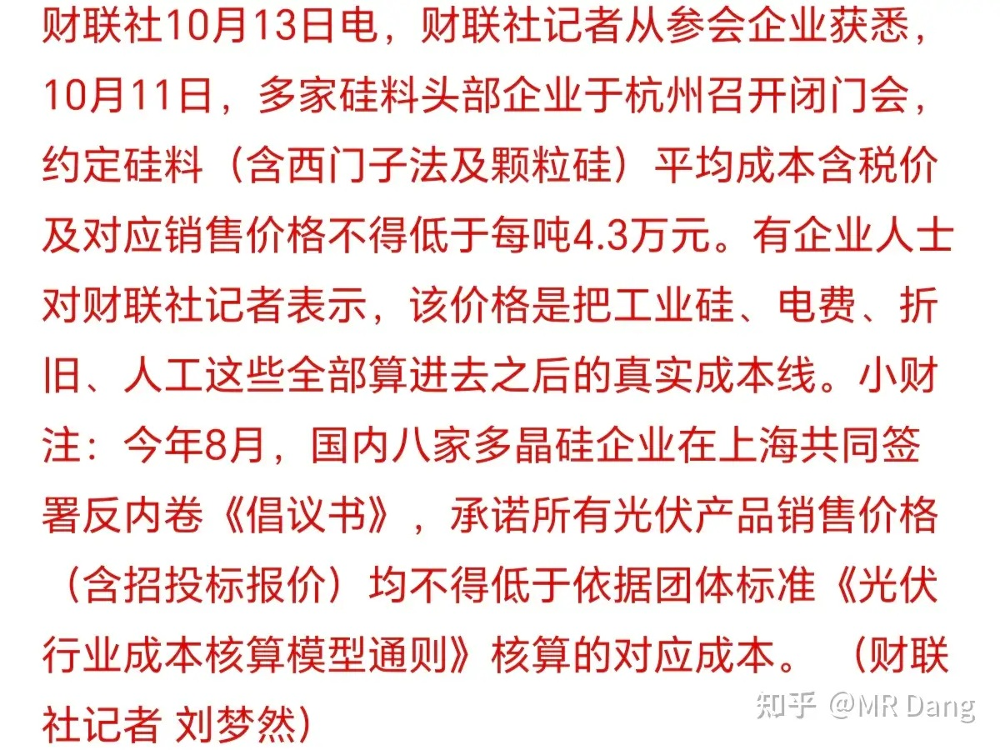
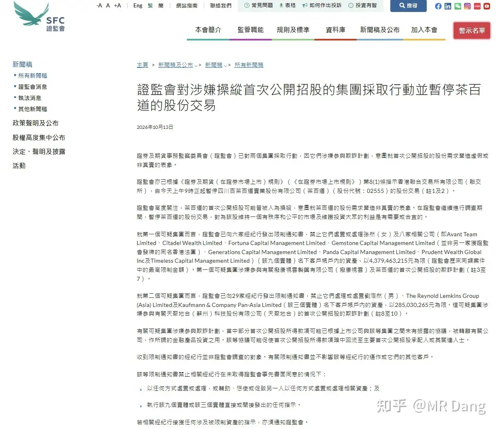
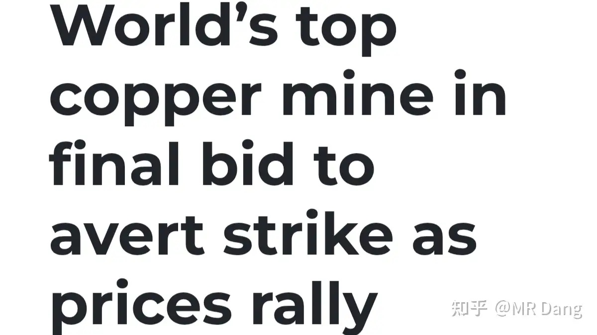
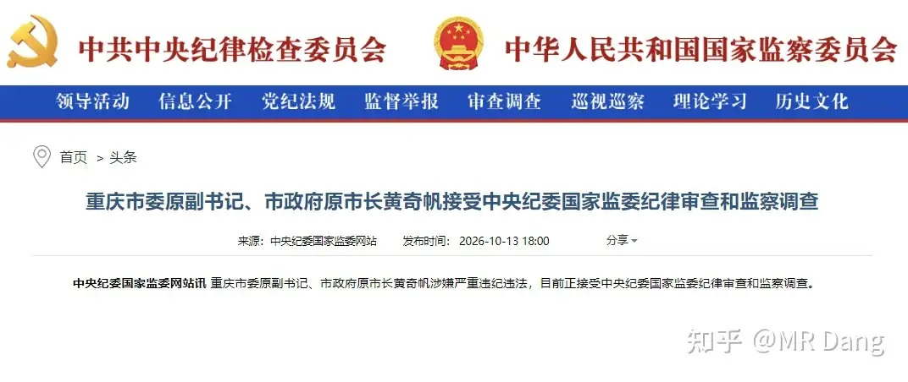
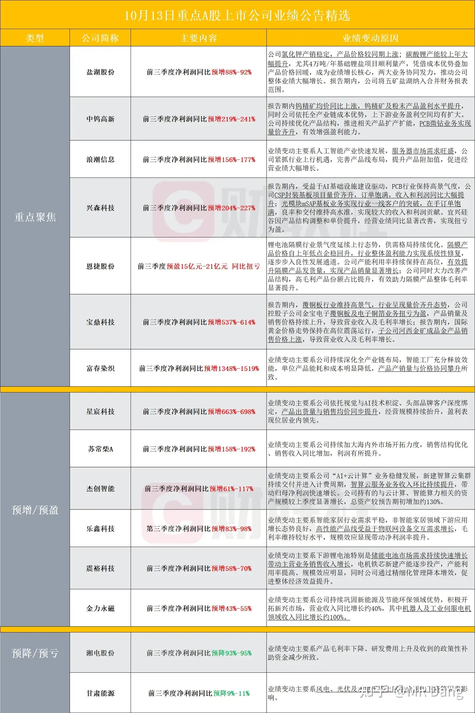
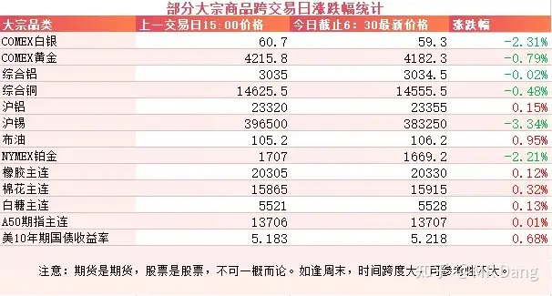
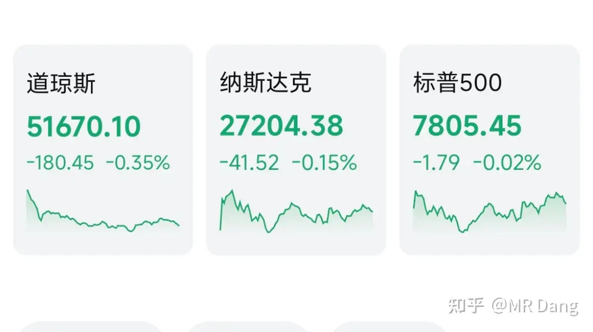
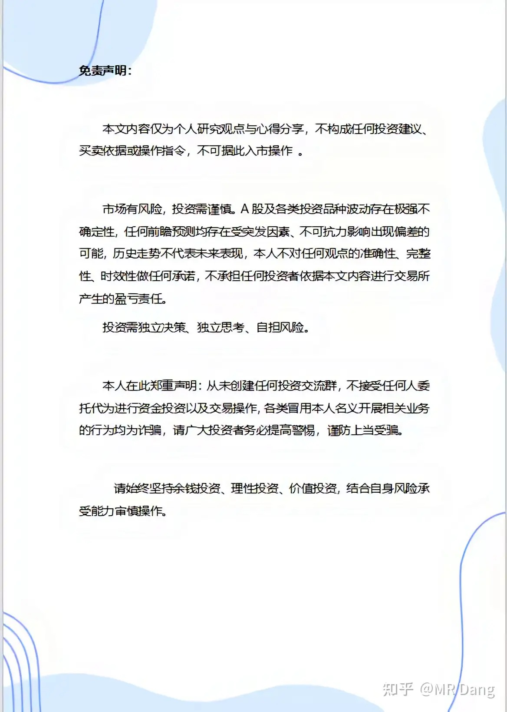

# 如何看待2026年10月14日A股行情走势？

---

**发布时间**: 2026-10-14 07:52  |  **原文链接**: https://www.zhihu.com/question/2093206738912785585/answer/2093604542017553111  |  **点赞数**: 162 人赞同

**作者信息**: MR Dang | 证券从业资格证持证人

---

## 正文内容

### 光伏反内卷

最近传出光伏反内卷的进展，目前落地的成本价是4.3万/吨。

之前8月份的时候不是签了个反内卷的《倡议书》么，当时只说不低于成本，没说成本是多少，现在算出来是含税价4.3万。

这个价格什么概念呢？目前的多晶硅主连期货价格是3.5万，这中间差距大的不是一星半点。

整体看下来对硅料企业是好事，联合挺价，拒绝内卷。

但是有几个问题还是要面对的，比如说现货和期货差价这么大，怎么防止套利？

价格定到4.3万，内卷会不会换一种形式，通过一些手段，变相降价？

下游厂商怎么办，成本提高，但是需求没增加，价格传导不到末端的话，最后只能是下游企业吃亏。

另有消息称下游BC组件报价不得低于0.86每瓦，TOPCon组件报价不得低于0.79每瓦。

这个感觉执行起来更难，厂商这么多，又不是几家，怎么监督是个大问题。

说到底，目前多晶硅国内产能是350万吨，开工率只有40%不到。

而全球需求只有130万吨左右，去产能的路，道阻且长。

---

### 港股反欺诈

昨天香港证监会发了个公告，对涉嫌IPO欺诈的集团采取措施，并且暂停了茶百道的交易。

同时被公布的还有欺诈模式的运作过程，大体上可以分为四步。

第一步就是找托。主要是一些关联投资人，去认购国际配售股份，制造需求旺盛的表象。

第二步就是返利。通过支付异常高昂的包销佣金和其他上市开支，将资金从上市公司转移给包销商，再由后者回流给托。

第三步就是回流。第二步那点钱只是开胃菜，这个才是主菜。回流就是把IPO募集来的资金去买所谓的理财产品。

而这些买理财产品的钱最后又回到了幕后黑手的手里。

如此一来，钱也有了，股也有了，可谓是空手套白狼。

最后一步就是割韭菜。因为股权集中在少数人手里，实际流通市值比较小，有利于操纵，最后把这些白得的股票再高价处理给韭菜。

可谓是一鱼四吃，反复收割的典范。

至于认定金额方面，前几次都是一两亿级别，这次直接提高到了四五十亿港币级别。

港股近些年表现不佳，其中一个很重要的原因是IPO太随意了，门槛过低影响了市场整体形象。

搞的像个万能备胎一样，好多企业都是在别的地方上不了，最后实在没办法，心有不甘的赴港上市。

所以香港证监会这次还打算修订《证券市场上市规则》，加强对市场的监管。

---

### 铜矿罢工

埃斯孔迪达（Escondida）是全球最大铜矿，由必和必拓运营，位于智利北部，是目前全球唯一一座年产量超100万金属吨的铜矿。

最近以来由于铜价走高，工会要求更高的薪酬，威胁进行罢工。

必和必拓给出的最新方案是每人约2.55万美元签约费。

工会承认这个费用回应了部分诉求，但认为奖金低于市场水平，要求在铜价暴利下分享更多利润，说人话，就是收入要和公司利润挂钩。

今天是两边谈判的最后一天，如果谈不拢，可能会进行罢工，影响铜矿的供应端。

铜的长期需求是景气的，长期供应也是紧缺的，品位越来越低，现在有投行（比如BMI）给出的长期目标价（2035年）达到了17000美元。

老外的工会制度也是一个推手，铜价越涨，公司越挣钱，越挣钱就越要闹罢工，闹了罢工，供应越少，铜价就越涨，完美闭环了属于是。

---

### 然后还有个事，可以了解一下

---

### 部分企业三季报业绩情况

整体看下来，很多科技板块企业的三季度确实业绩不错，和宏观数据也是相符的。

---

### 大宗商品

有色表现不佳，贵金属走弱，锡最近波动也比较大，回调了三个多点，铜铝稍好一些。

原油和农产品都在高位，这两都是通胀的发动机。

美债收益率也在高位。

A50看不出太明显的倾向。

### 外围市场

美三大股指继续回调，道指领跌。

板块上存储，Ai硬件走弱，油气类走强。

昨天的韩股也是崩了个大的，存储也在回调。

---

昨天个人组合净值回撤近一个点，银行绿一个半，资源红大半个点，消费绿一个多，电网绿大半个。

两天玩了个寂寞，净看热闹了。

市场情绪现在难以捉摸，睡个午觉就会产生新的变数。

深成指，创业板指，恒科都在昨天盘中联袂创出年内新低。

尽管最后又V回来一些，但是整体情绪依然比较悲观。

我对咱们的资本市场是有信心的，但是目前的美债收益率实在太高了，乐观的看法不太适宜直接转化为行动。

---

评论区不是我关的。。。嗯。。。

---

### 一个喜欢保护韭菜的博主，希望大家少少踩坑，多多赚钱！！！

> [!comment]- 点击展开评论
>
> | 用户 | 时间 | 内容 |
> | :--- | :--- | :--- |
> | Asduyhj |  | 没啥用，光伏企业必须倒闭个几家头部企业 |
> | 霹雳蝴蝶 |  | 铜矿涨价要给矿工多发工资...凭啥啊[捂脸] |
> | 小虼蚤 |  | 光伏企业是请不起法顾吗？ |
> | &nbsp;&nbsp;&nbsp;&nbsp;大鱼 |  | 有可能你说的是真的[打招呼] |
> | &nbsp;&nbsp;&nbsp;&nbsp;小虼蚤 |  | 每次都出这种傻福招数，第一次都被警告了，第二次居然还来[打招呼] |
> | 魔刀千刃 |  | 干光伏 |
> | 茶楼欧诺情侣 |  | [感谢][感谢] |
> | 瑞布克 |  | 咦？？？ |
> | 德吉 |  | [感谢][感谢] |
> | 我是一颗桃子吖 |  | 早[感谢] |
> | 11119999 |  | 牛 |
> | 狸花猫 |  | 爱旭已经亏了20个点了[酷] |

---

*本文件从 MR Dang 知乎页面转载*

**作者**: MR Dang  
**链接**: https://www.zhihu.com/question/2093206738912785585/answer/2093604542017553111  
**来源**: 知乎

*著作权归作者所有。商业转载请联系作者获得授权，非商业转载请注明出处。*

---

## 相关阅读

- [[20261013-如何看待2026年10月13日A股市场行情？|上一篇：如何看待2026年10月13日A股市场行情？]]
- [[20261015-如何看待2026年10月15日A股午间收盘沪指跌近2%失守3700点？|下一篇：如何看待2026年10月15日A股午间收盘沪指跌近2%失守3700点？]]
