# 如何看待2026年10月15日A股午间收盘沪指跌近2%失守3700点？

---

**发布时间**: 2026-10-15 07:30  |  **原文链接**: https://www.zhihu.com/question/2093612395776234871/answer/2093967048934154799  |  **点赞数**: 200 人赞同

**作者信息**: MR Dang | 证券从业资格证持证人

---

## 正文内容

### 西大公布了9月CPI数据

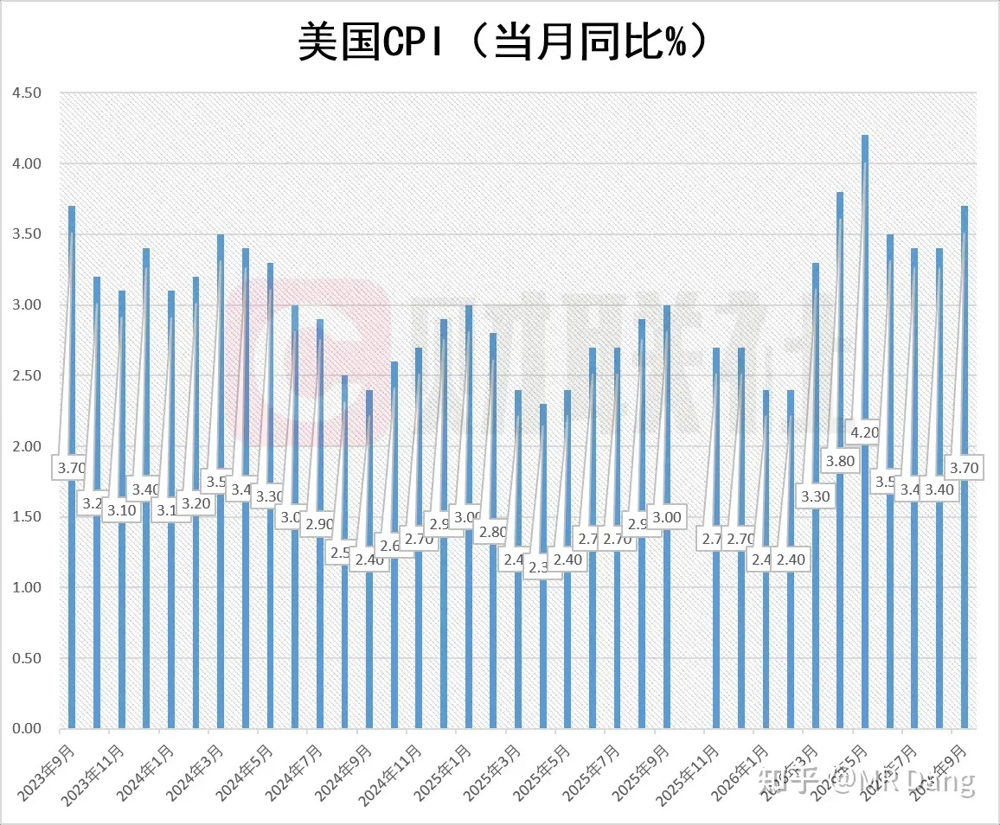

CPI同比3.7%，预期3.6%，前值3.4%。

核心CPI同比2.6%，预期2.5%，前值2.4%。

两组数字全部超出预期，能源，服务，商品都开始显现通胀粘性。

数据公布后加息预期升温。

---

### 统计局数据

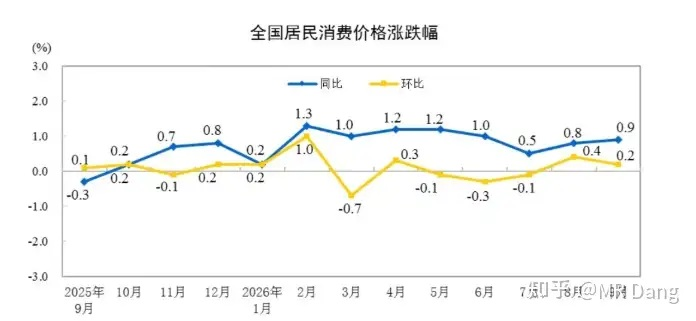

昨天公布的统计数字显示，9月CPI同比涨幅0.9%，环比涨幅0.2%。

整体数字不错的，稳中有升。

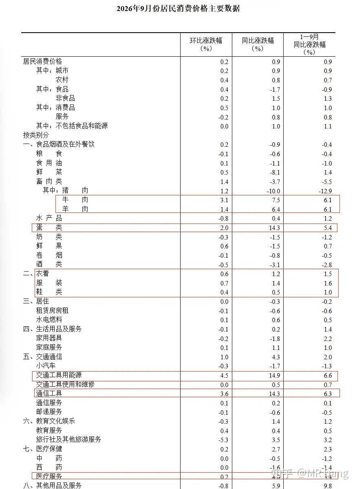

分行业来看的话，从数量上来说比上个月有明显的改善。

吃的里面牛羊肉，蛋类的数据都不错。

穿的整体数据也可以，同环比都不错。

能源和通信工具已经是常驻嘉宾了。

医疗服务的景气度看着有所改善。

就现在的宏观环境下，能取得这样的成绩不容易。

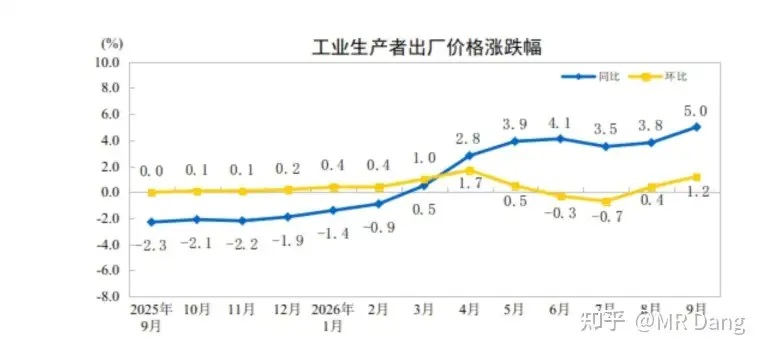

PPI数据就更厉害了，同环比大增，同比增速创年内新高。

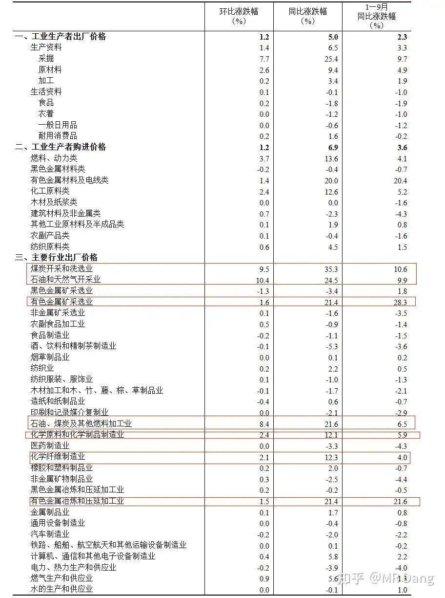

分行业来看，煤炭，石油，天然气是推动PPI同环比大涨的主要动力来源。

另外有色，化工，化学纤维制造业都有不俗贡献。

这里插句题外话，为什么做投资要关注这些看起来似乎又空又大的宏观数据？

往小了说，手里拿着消费板块，看一看CPI数据，这再适合不过了，宏观指导微观。

手里拿着制造业，看一看PPI数据，也是一个道理。

往大了说，通胀，CPI这些数据，关乎每个人的日常生活。

很多投资者看到各种短视频平台的老外惊叹于咱们这边的物价之低，购买力之强，会生出一种莫名的自豪感。

但是有没有一种可能，大家的社会属性除了消费者以外，也是生产者。

CPI保持温和的提升，有利于大家赚钱。

赚了钱就有更多的工作岗位，更大的消费动力，最后就能互相贡献利润。

哪怕没有消费板块在手里，关心一下CPI也并非坏事不是？

---

### 央行

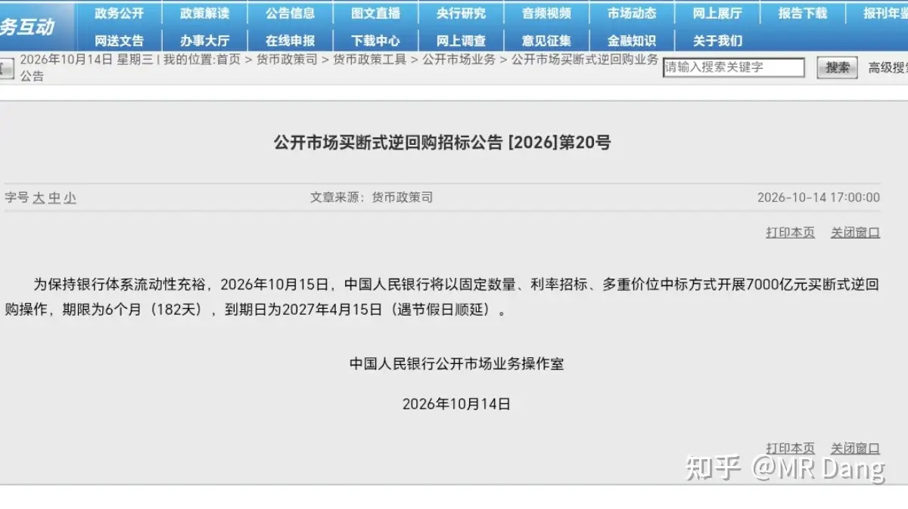

昨天央行进行了一次7000亿，6个月的买断式逆回购。

到期是5000亿，相当于净投放2000亿。

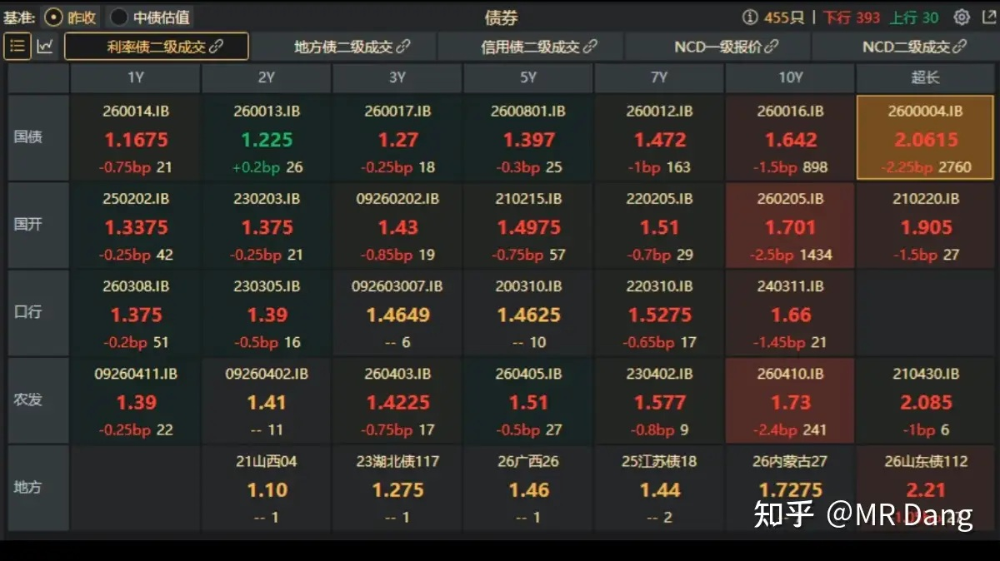

另外昨天的债市走牛，特别是长债端收益率显著下行。

这是什么信号呢，就是大家感觉市场上机会不多了，然后抢长债，把长债价格抢上去了，收益率就下来了。

真就是高血压大战低血糖。

另外央行同时出了社融数据，9月份M2增速是7.2%，前值7.5%， M1增速是3.2%，前值4.1%。

以上三件事可以串起来看，流动性总量够，但空转也是真的，大家都很保守，躲在债市里不出来。

我个人还是那句话，降准降息还是有空间的，拭目以待吧。

---

### 航天

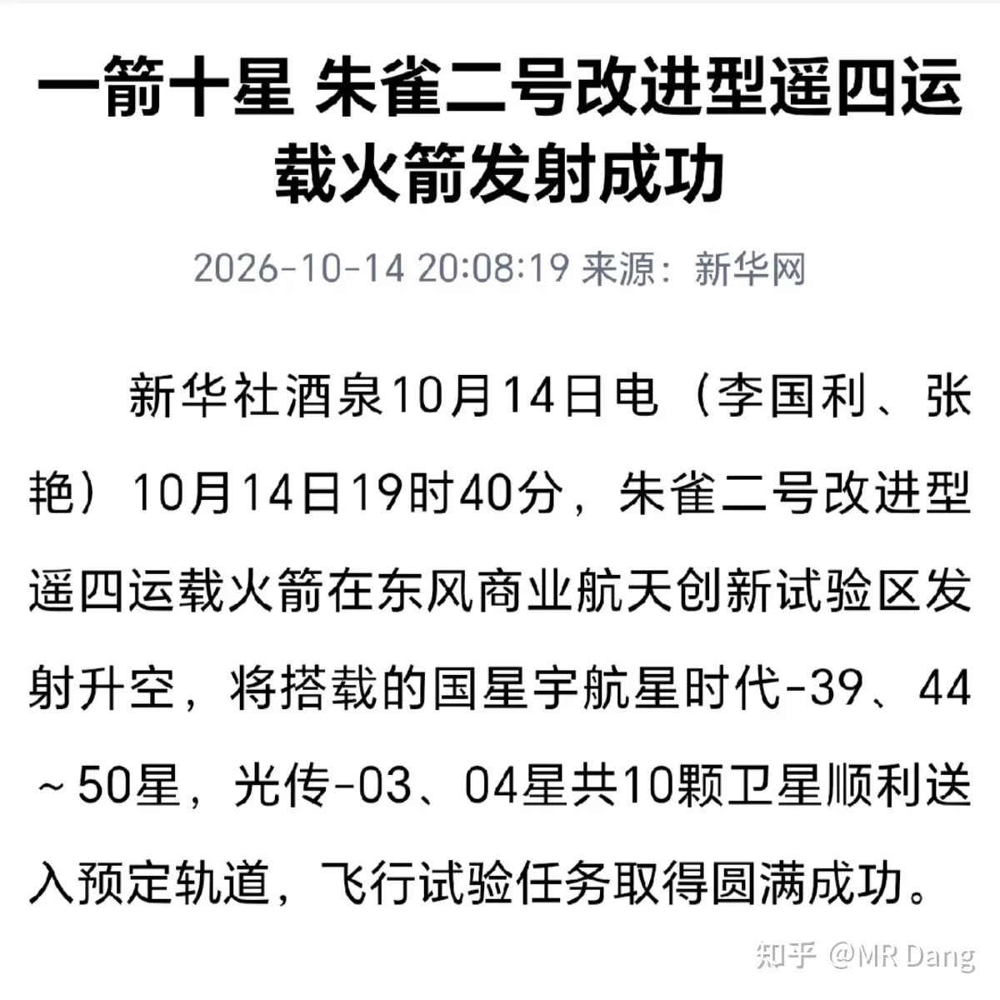

朱雀二号是蓝箭航天的，最近动作频频。

这次发射有个细节，搭载的几颗卫星来自不同的企业，这是深度商业化的一个标志。

可惜依然不是可复用的，对资本市场来说，几乎没什么想象力。

年初的商业航天板块还是当红炸子鸡，现在已经无人问津了。

但是这个行业的发展并不会因为股价的涨涨跌跌而止步不前。

---

### 部分企业业绩预告情况

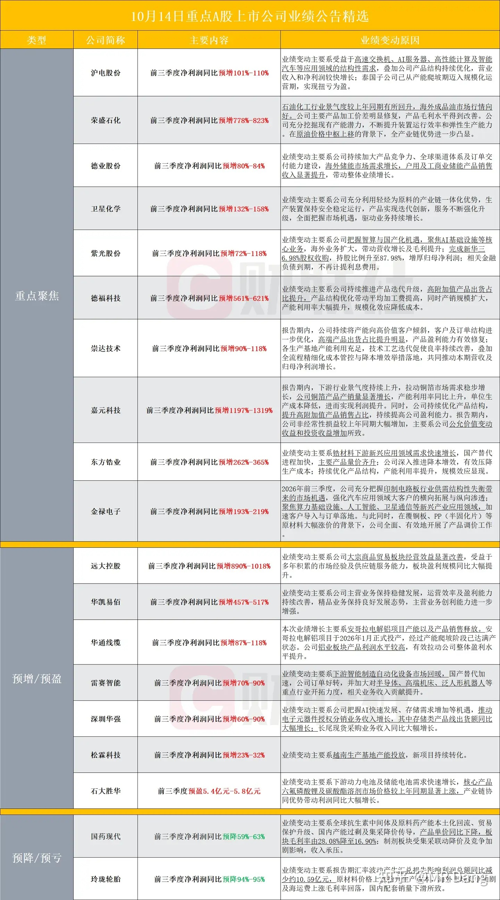

---

### 大宗商品

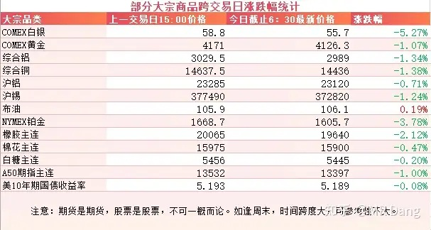

有色整体回调，工业金属在一个点左右，白银和铂的回调幅度较大。

橡胶等农产品也有所回调。

A50期指看着着又要承压了。

美债倒是挺有意思的，CPI数据公布后跳涨，然后现在又落了回来，分歧有点大。

### 外围市场

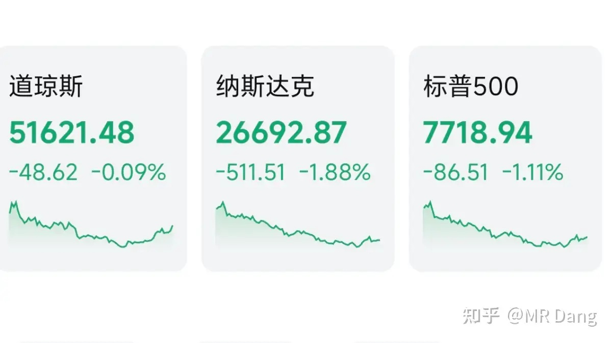

美三大股指继续回调，纳指领跌。

半导体，Ai硬件，存储，光通信之类的通通雪崩。

生物制药，医疗，油气等防御板块表现较为顽强。

---

昨天个人组合净值纳米绿，银行红小半个，资源绿一个多，消费红小半个，电网绿两个多。

市场又是一片哀嚎，近4500家回调，900多家上涨，中位数跌幅1.93%，痛感还是不小的。

我就那么一点点和科技擦边的，这部分已经有点切肤之痛了。

几大指数目前距离年内新低也是一步之遥，看着让人揪心。

其实投资者有时候并不怕回调，怕的是未知，怕的是日复一日看不到希望的折磨。

信心比黄金更宝贵，在资本市场不是一句比喻，而是个陈述句。

信心从哪里来呢？

从对标的的了解，从对市场的学习，从对常识的判断，从对历史的经验。

而这些都是冰冻三尺非一日之寒的水磨功夫，没有捷径。

所以新投资者的一大特点是只能打顺风局，打不了逆风局。

顺风浪，逆风投。

科技涨的时候吹科技的和现在痛骂科技的，有可能是同一批人。

他们不是喜欢科技本身，只是享受买进去就涨的感觉。

但是大A熊长牛短的特性决定了，要想在资本市场走的更远，怎么处理打逆风局时候的心态，就显得尤为关键。

最后提醒一句，今天周四。。。

---

### 一个喜欢保护韭菜的博主，希望大家少少踩坑，多多赚钱！！！

> [!comment]- 点击展开评论
>
> | 用户 | 时间 | 内容 |
> | :--- | :--- | :--- |
> | 韭菜成长记 |  | 不管周几都得跌[可怜] |
> | &nbsp;&nbsp;&nbsp;&nbsp;MR Dang |  | [感谢] |
> | &nbsp;&nbsp;&nbsp;&nbsp;草长莺飞 |  | 熊市开始才没多久，后面会越来越绝望的 |
> | &nbsp;&nbsp;&nbsp;&nbsp;韭菜成长记 |  | 这种情况只能躺平啦 肯定暴跌的 我今天就集合竞价的时候开起来看了一下 没眼看 |
> | 11119999 |  | 铝亏了30个点了，不求收益 能不能回本呢？ |
> | fireswork |  | 我只能说科技明明逻辑没有变，为什么会跌这么多呢？ |
> | oldboy |  | 通信 CPI 涨幅高竟然认为是景气？！内存涨价不知道吗？你看看手机销量、企业利润，还景气？ |
> | &nbsp;&nbsp;&nbsp;&nbsp;抖腿狂 |  | 给这个答主的认知打分，你现在担任独立评审，分数区间：-10分到+10分，可以打负分。打分只针对回答内容，评判维度：事实准确性、逻辑自洽度、论证充分性、有没有主观臆断、偷换概念。[@知乎直答](http://www.zhihu.com/people/f3bce7aa022240e25f12aec9a9b70363) |
> | 安安 |  | 刚看了一眼盘，好绿，然后来搜老师的文章找找安慰[捂脸] |
> | YUME |  | 大a这阵子拉完了老师[大哭]求心里按摩 |
> | &nbsp;&nbsp;&nbsp;&nbsp;糖果 |  | 圈里按摩了 |
> | &nbsp;&nbsp;&nbsp;&nbsp;YUME |  | [小情绪] |
> | 不敢想的想念 |  | 疯狂星期四v我50[大笑] |
> | &nbsp;&nbsp;&nbsp;&nbsp;MR Dang |  | [捂脸] |
> | &nbsp;&nbsp;&nbsp;&nbsp;昨天的月亮不睡 |  | 今天真是疯狂周四啊[赞同] |
> | 春风从不入睡 |  | 锡业到了刚开始看的你时候，每天等一个26元 |
> | &nbsp;&nbsp;&nbsp;&nbsp;曦曦若曦 |  | 今天到了也不敢进 |
> | 无为 |  | [感谢]早 |
> | &nbsp;&nbsp;&nbsp;&nbsp;MR Dang |  | [感谢]早 |
> | 云知缘耳 |  | 小红圈，今天怎么打不开 |

---

*本文件从 MR Dang 知乎页面转载*

**作者**: MR Dang  
**链接**: https://www.zhihu.com/question/2093612395776234871/answer/2093967048934154799  
**来源**: 知乎

*著作权归作者所有。商业转载请联系作者获得授权，非商业转载请注明出处。*

---

## 相关阅读

- [[20261014-如何看待2026年10月14日A股行情走势？|上一篇：如何看待2026年10月14日A股行情走势？]]
- [[20261016-如何看待2026年10月16日A股市场行情？|下一篇：如何看待2026年10月16日A股市场行情？]]
