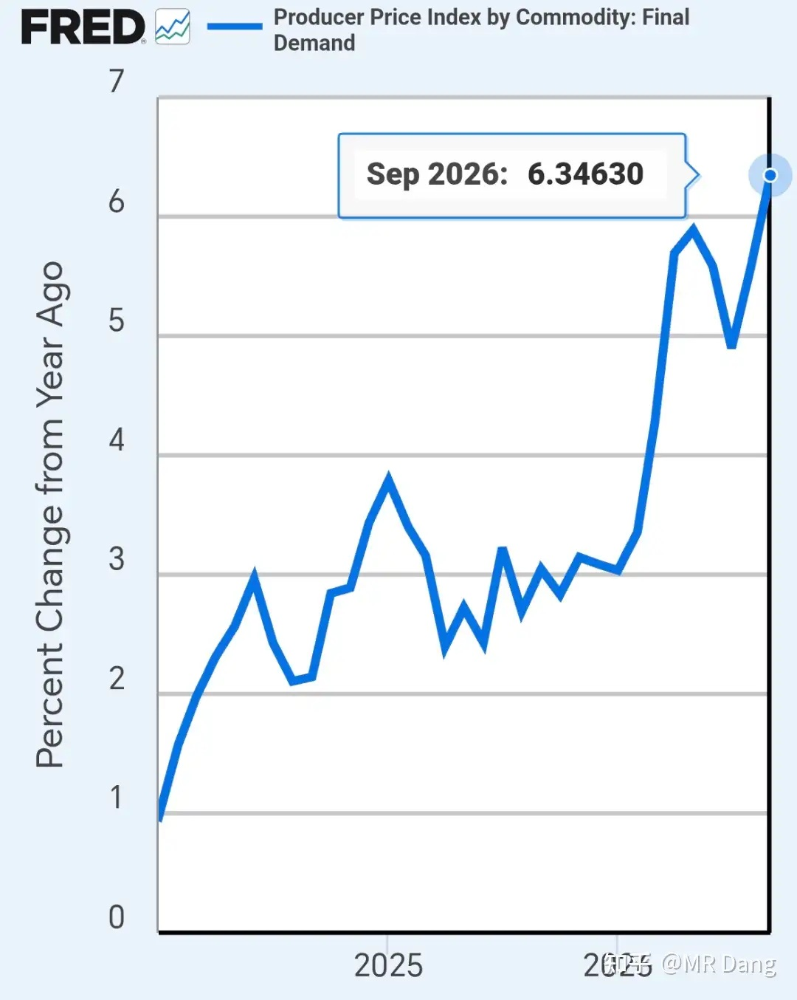
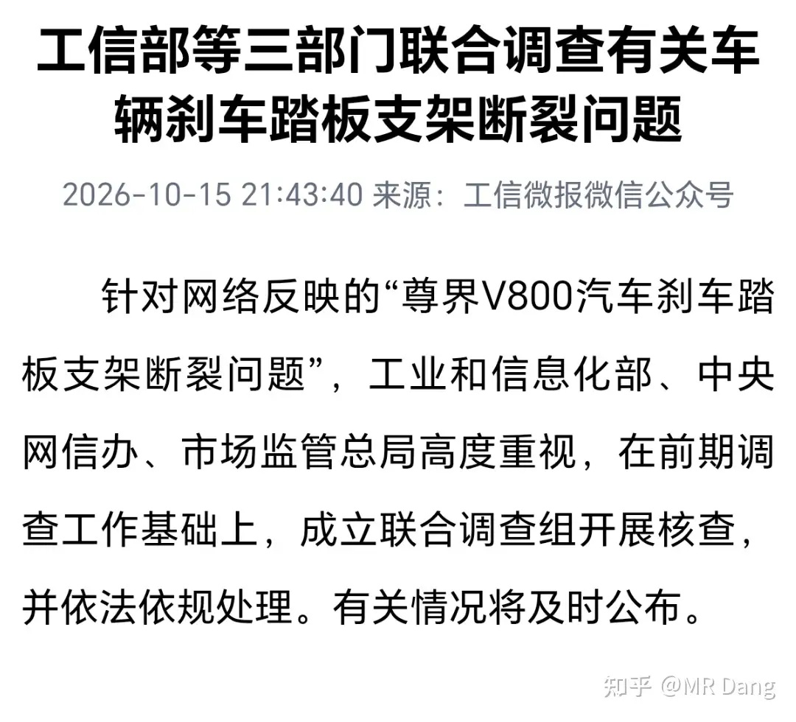
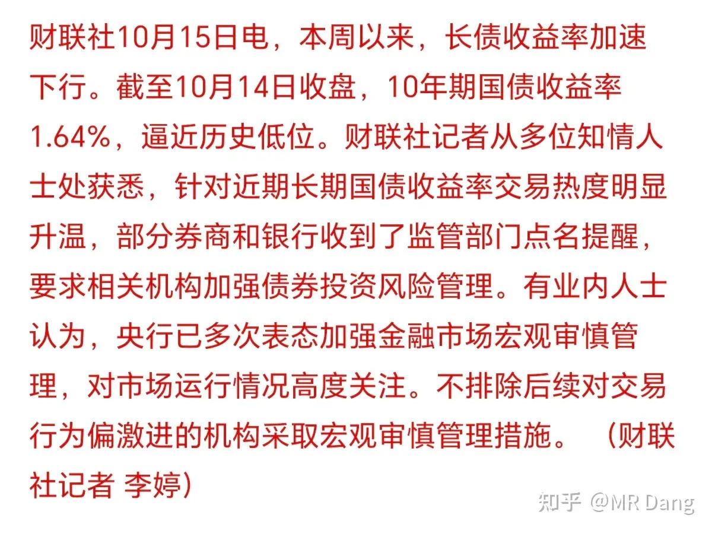
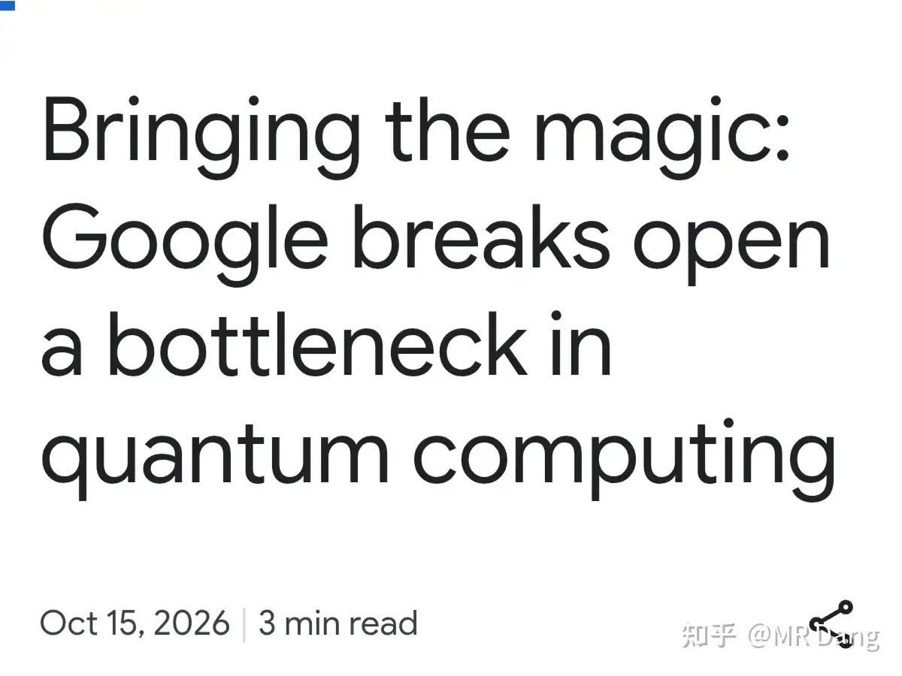
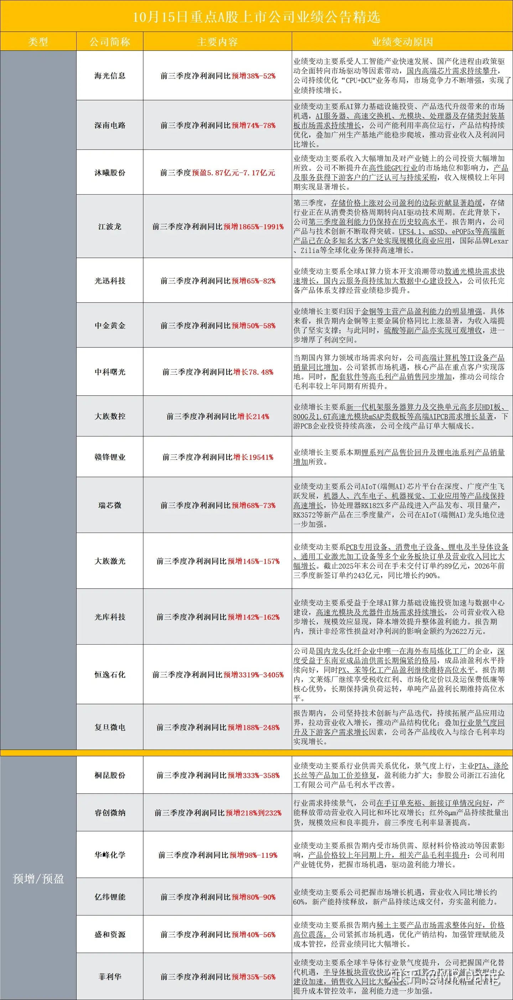
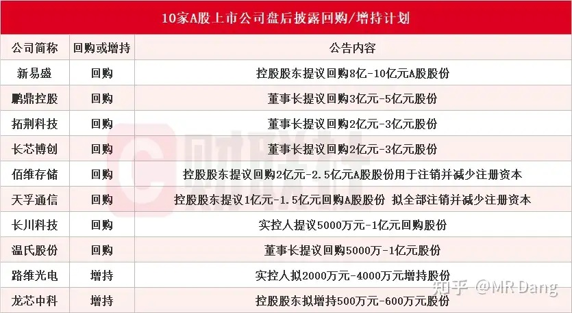
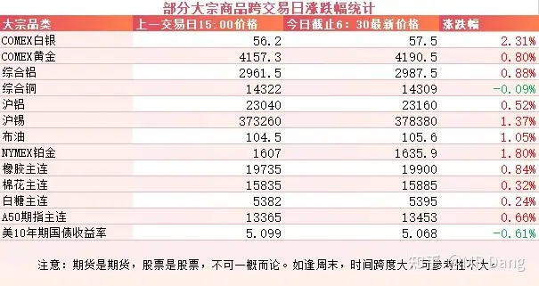
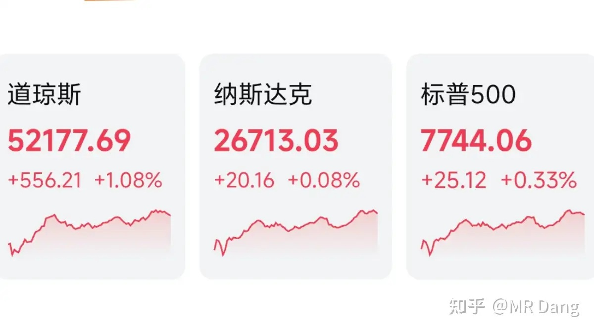
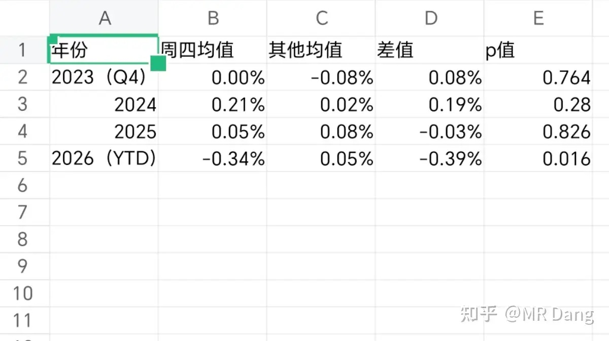

# 如何看待2026年10月16日A股市场行情？

---

**发布时间**: 2026-10-16 07:31  |  **原文链接**: https://www.zhihu.com/question/2091547912924821467/answer/2094329522569139858  |  **点赞数**: 178 人赞同

**作者信息**: MR Dang | 证券从业资格证持证人

---

## 正文内容

### PPI

西大发布了9月的PPI数据，大超此前的5.3%预期，直接跳涨到了6.3%。

数据一出，有投资者已经开始琢磨衰退的事情了，有人担忧这么高的利率会不会压垮经济。

所以现在除了交易通胀，又多出来一个新选项，就是交易衰退。

---

### 刹车踏板事件

事情闹的太大，这下可以等官方通报了，不管怎么说，这事难以善了，总有人要为这事负该负的责任。

---

### 债市

这个简单点说，叫窗口指导，没正式文件，提醒一些机构注意着点，别太过分了。

抢长债其实是看空经济，对未来长期是不看好的，不然完全可以来大A享受发展带来的红利。

上次有类似情况发生的时候要追溯到去年1月10日，后面债市和资本市场发生的事情也可以复盘下。

不会简单的重复，但是也有一定借鉴意义。

现在只是动口，如果这些机构不上道，说不定还会直接动手。

---

### 量子科技

谷歌团队在Science上发了一篇论文，首次在Willow芯片上实验验证了魔态培育技术，可以大幅降低错误率，同时创造了T态逻辑保真度的最高水平。

魔态这个概念2004年就有了，但怎么低成本制备一直卡了20年，这次算是把卡脖子的地方撬开了。

---

### 部分企业业绩预告情况

粗粗一看，很多企业同比增长不错，其实环比都是下降的，不算有多超预期。

---

### 回购

企业不约而同的开始回购了，有点救市的感觉。

怎么说呢，市场要想好，得自己争气，没有哪一个市场是单纯靠外力救起来的。

根正才能苗红。

---

### 大宗商品

有色整体有所反弹，不过幅度一般，一个点左右，白银稍强。

原油和农产品也都有些许涨幅。

A50看着蛮喜庆的。

密集回购，而且宽基ETF也有放量迹象，外加债市的窗口指导，希望这套救市组合拳能打出威力来。

美长债收益率下滑，有些资金已经开始提前做衰退交易了。

### 外围市场

美三大股指集体收红，道指领涨。

关注度最高的半导体和Ai硬件几乎把开盘以后的失地都抢了回来，没怎么跌。

生物制药，有色，应用软件等板块表现较好，美股的mRNA疫苗一直在创新高。

---

昨天个人组合净值回撤近两个点，银行绿一个多，资源绿近四个点，消费绿一个多，电网绿两个半。

市场已经有点风声鹤唳，400多家红色的，5100多家绿色的，上证，深成指，创业板外加一个恒科，全部创年内新低。

中位数跌了3%，这个痛感会明显大于周三。

所以被打疼了的话，不要怀疑自己是敏感肌，确实是疼。

然后我突然觉得黑色星期四好像还真不是空穴来风啊，就让Ai跑了一下，结果如下：

Ai告诉我说，黑色星期四现象在其他年份不算明显，但是在今年异常显著，单日均值差出去接近0.4%了。

这简直是个惊人的发现，我强烈建议量化因子把这个策略加进去，抹平这个差距。

另外还有发愁毕业论文的，这玩意儿真能写一篇，不比那些学术厕纸强多了。

我提出的猜想是今年肯德基活动力度大，每到周四都需要取钱去买那个好吃的锡纸包鸡，所以影响了资本市场的流动性。

然后我又跑了一下星期五，星期五比星期四从统计学来说，在长周期范围内更显著一些，说人话就是除了今年以外星期五更黑。

这个其实好理解，毕竟要过周末，有避险需求，类似于节前平均表现比较差一样。

---

### 一个喜欢保护韭菜的博主，希望大家少少踩坑，多多赚钱！！！

> [!comment]- 点击展开评论
>
> | 用户 | 时间 | 内容 |
> | :--- | :--- | :--- |
> | mzwww |  | 我也做了一个统计，最安全的就是周六和周日这两天。 |
> | &nbsp;&nbsp;&nbsp;&nbsp;MR Dang |  | [捂脸] |
> | &nbsp;&nbsp;&nbsp;&nbsp;一起走过的日子 |  | 所以我现在越来越喜欢休息日，身心舒畅，没人乱扣我钱 |
> | &nbsp;&nbsp;&nbsp;&nbsp;宇文华夏 |  | [酷]我通过研究也发现了缅A想要止跌必须做到以下三点，那就是下午三点。 |
> | 琅琊笑笑生 |  | 懂了，周三尾盘卖，周五尾盘买[doge] |
> | &nbsp;&nbsp;&nbsp;&nbsp;MR Dang |  | [感谢] |
> | Amanda |  | 周一观望，周四黑天鹅，周五避险，一周还剩下2天[笑哭] |
> | &nbsp;&nbsp;&nbsp;&nbsp;胖胖鱼 |  | 你就没进场？ |
> | &nbsp;&nbsp;&nbsp;&nbsp;宇文华夏 |  | [飙泪笑]周二买周三卖就对了 |
> | &nbsp;&nbsp;&nbsp;&nbsp;李吉 |  | 我真是这么操作的[捂脸]，不过原因是因为我周二周三放假 |
> | saintluffy |  | 超前博弈黑色星期五，所以变成黑色星期四了，等黑四形成共识，就变成黑色星期三了[捂嘴] |
> | 从伊而终 |  | 我清晰的记得，一年前的今天，我向你请教银行股的投资方法，时光荏苒，我也是一年的股民了，这一年行情跌宕起伏，算是见识了市场的凶险，一直很认同您的一句话，能一直待在牌桌上的才是赢家，越你能陪大家走的更远，不计较眼前得失。 |
> | 栗香西红柿炒鸡蛋 | 22 小时前 | 锡纸包鸡真那么好吃吗？从来没试过[思考] |
> | 荆棘鸟 | 2 小时前 | “来大A享受发展带来的红利”这句竟然有下影线[思考] |
> | 回声 |  | 早[感谢] |
> | &nbsp;&nbsp;&nbsp;&nbsp;MR Dang |  | [感谢] |
> | 蛮王石头人 |  | 今年其实都很疼[生气] |
> | &nbsp;&nbsp;&nbsp;&nbsp;MR Dang |  | [感谢] |
> | 帅小伙 |  | 老师早[感谢] |
> | &nbsp;&nbsp;&nbsp;&nbsp;MR Dang |  | [感谢]早 |

---

*本文件从 MR Dang 知乎页面转载*

**作者**: MR Dang  
**链接**: https://www.zhihu.com/question/2091547912924821467/answer/2094329522569139858  
**来源**: 知乎

*著作权归作者所有。商业转载请联系作者获得授权，非商业转载请注明出处。*

---

## 相关阅读

- [[20261015-如何看待2026年10月15日A股午间收盘沪指跌近2%失守3700点？|上一篇：如何看待2026年10月15日A股午间收盘沪指跌近2%失守3700点？]]
